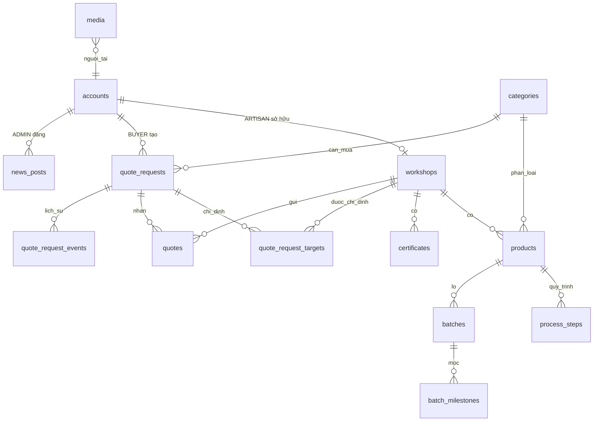

# Mô hình dữ liệu

> **Nguồn sự thật của schema là các file Flyway** trong `backend/src/main/resources/db/migration/`. Tài liệu này mô tả ý đồ. Mục 1 là hiện trạng (V1–V3). Mục 2 là **đề xuất**, chưa có migration; khi viết migration cho một bảng, cập nhật lại mục tương ứng và chuyển nó lên "hiện trạng".

## 1. Hiện trạng (Flyway V1–V3)

| Bảng | Cột | Ghi chú |
|---|---|---|
| `workshops` | `id`, `slug` (unique), `name`, `approved` (bool, mặc định true) | Xưởng/hộ. |
| `categories` | `id`, `slug` (unique), `name` | Phân loại. |
| `products` | `id`, `workshop_id` → workshops, `category_id` → categories, `slug` (unique), `name`, `description`, `image_path` | Loại sản phẩm. |
| `accounts` | `id`, `username` (unique, `^[a-z0-9-]{3,60}$`), `password_hash`, `role` (`BUYER`/`ARTISAN`/`ADMIN`), `workshop_id` (unique) | Ràng buộc: `role = 'ARTISAN'` ⇔ có `workshop_id`. |
| `account_sessions` | `token_hash` (PK), `account_id` → accounts (cascade), `expires_at` | Phiên đăng nhập. |

## 2. Đề xuất mở rộng

Sơ đồ quan hệ:

### 2.1. Bổ sung bảng hiện có

- `workshops`: `description`, `family_history`, `address`, `phone`, `contact_email`, `latitude`, `longitude`, `opening_hours` (văn bản hoặc JSON theo thứ), `accepts_visitors` (bool), `approved_at`, `featured` (bool), `cover_media_id`.
- `products`: `reference_price`, `hidden` (bool), `featured` (bool); thay `image_path` bằng liên kết bộ ảnh (giữ cột cũ đến khi chuyển xong dữ liệu).
- `accounts`: `display_name`, `phone`, `contact_email` (thông tin liên hệ Buyer cho FR-QUOTE-09).
- Mọi bảng nghiệp vụ: `created_at`, `updated_at` (`TIMESTAMPTZ`).

### 2.2. Bảng mới

| Bảng | Cột chính | Ghi chú |
|---|---|---|
| `media` | `id`, `owner_account_id`, `original_name`, `content_type`, `size_bytes`, `width`, `height`, `path_thumb`, `path_medium`, `path_large`, `created_at` | Một dòng cho mỗi ảnh đã upload cùng các biến thể. |
| `media_links` | `media_id`, `entity_type` (`WORKSHOP`/`PRODUCT`/`PROCESS_STEP`/`BATCH`/`BATCH_MILESTONE`/`NEWS`/`CERTIFICATE`/`QUOTE_REQUEST`), `entity_id`, `position` | Gắn ảnh vào thực thể, có thứ tự; `position = 0` là ảnh bìa. Phương án thay thế: bảng nối riêng cho từng thực thể — chọn khi làm module MEDIA. |
| `certificates` | `id`, `workshop_id`, `name`, `issuer`, `issued_on` | Ảnh qua `media_links`. |
| `process_steps` | `id`, `product_id`, `position`, `name`, `description` | Quy trình dùng chung của sản phẩm. Unique (`product_id`, `position`). |
| `batches` | `id`, `product_id`, `workshop_id`, `code` (mã lô hiển thị), `public_code` (unique, ngẫu nhiên, dùng trong URL/QR), `name`, `description`, `kind` (`IN_STOCK`/`MADE_TO_ORDER`), `quantity`, `unit`, `reference_price`, `supply_capacity`, `available_from`, `visibility` (`PUBLIC`/`PRIVATE`), `share_token` (nullable, cho lô riêng tư — Q-02), `partner_note` (Q-05), `featured` | `workshop_id` lặp lại từ product để truy vấn/kiểm quyền nhanh; phải khớp với xưởng của product. |
| `batch_milestones` | `id`, `batch_id`, `process_step_id` (nullable), `title`, `note`, `happened_on` (DATE) | "Mảng mốc thời gian + ảnh chứng minh" của đề gốc 4.1 (Q-10). Sắp theo `happened_on`. |
| `quote_requests` | `id`, `buyer_account_id`, `category_id`, `title`, `quantity`, `unit`, `spec` (yêu cầu kỹ thuật), `desired_by` (DATE), `bidding_deadline` (nullable — Q-15), `mode` (`TARGETED`/`OPEN`), `status`, `accepted_quote_id` (nullable), `version` (khóa lạc quan), `created_at`, `updated_at` | Trạng thái: xem `quote-state-machine.md`. |
| `quote_request_targets` | `request_id`, `workshop_id` (PK kép) | Chỉ dùng khi `mode = TARGETED`. |
| `quotes` | `id`, `request_id`, `workshop_id`, `unit_price`, `total_price`, `lead_time_days`, `note`, `status` (`SUBMITTED`/`WITHDRAWN`/`ACCEPTED`/`NOT_SELECTED`), `created_at`, `updated_at` | Unique (`request_id`, `workshop_id`). Unique một phần: mỗi `request_id` tối đa một dòng `status = 'ACCEPTED'`. |
| `quote_request_events` | `id`, `request_id`, `actor_account_id`, `from_status`, `to_status`, `note`, `created_at` | Lịch sử chuyển trạng thái (FR-QUOTE-11). |
| `news_posts` | `id`, `author_account_id`, `slug`, `title`, `body`, `kind` (`MATERIAL_PRICE`/`POWER_CUT`/`POLICY`/`EVENT`/`OTHER`), `event_start`, `event_end`, `event_place`, `hidden`, `published_at` | |
| `reports` | `id`, `reporter_account_id` (nullable), `entity_type`, `entity_id`, `reason`, `status` (`OPEN`/`RESOLVED`), `created_at` | FR-ADMIN-04 (P2). |

### 2.3. Chỉ mục cần có

`products(workshop_id)`, `products(category_id)`, `process_steps(product_id)`, `batches(product_id)`, `batches(workshop_id, visibility)`, `batch_milestones(batch_id)`, `quote_requests(buyer_account_id)`, `quote_requests(status, category_id)`, `quotes(request_id)`, `quotes(workshop_id)`, `media_links(entity_type, entity_id)`, `news_posts(published_at)`.

## 3. Quy ước schema

- Tên bảng/cột: `snake_case`, tiếng Anh, bảng ở số nhiều.
- Khóa chính `BIGINT GENERATED ... AS IDENTITY`. Thời gian `TIMESTAMPTZ`; ngày thuần `DATE`. Tiền `NUMERIC(15,2)` (VND).
- Enum lưu dạng `VARCHAR` + `CHECK`, giá trị viết HOA, khớp enum Java.
- Mỗi thay đổi là **một file migration mới** `V<n>__mo_ta_ngan.sql`; không sửa file đã merge vào nhánh chính. Số `n` kế tiếp hiện tại: **V4**. Hai người cùng thêm migration thì người merge sau đổi số.
- Dữ liệu mẫu đặt ở `db/seed/`, phải idempotent (`ON CONFLICT ... DO NOTHING`), không đặt trong migration.
- Entity JPA phải khớp schema vì `ddl-auto=validate`: thêm cột thì cập nhật entity trong cùng thay đổi.
