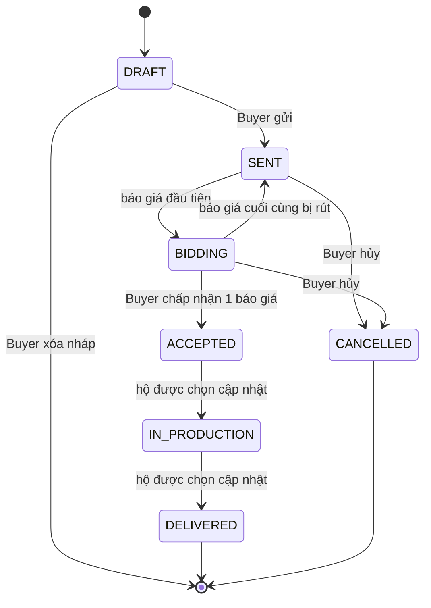

# Máy trạng thái yêu cầu báo giá

> Trạng thái tài liệu: **Nhóm đã chốt** các điểm nghiệp vụ ngày 2026-11-10 (Q-03, Q-04, Q-11, Q-14, Q-15, Q-31); chi tiết cài đặt (khóa, mã lỗi) là đề xuất kỹ thuật. Còn chờ: cách tổ chức tag (Q-38) — chỉ ảnh hưởng câu truy vấn "hộ phù hợp". Đáp ứng đề gốc §4.2 (6 trạng thái + khóa bản ghi) trong giới hạn của đặc tả (không quản lý hợp đồng/thanh toán/giao hàng).

> Hiện trạng 2026-11-14: luồng chỉ định một xưởng đã có API và giao diện. Service khóa dòng yêu cầu qua JDBC; sửa nháp kiểm tra `version` do client gửi dưới cùng khóa. Luồng mở và rút báo giá còn chờ Q-38 và phần chưa chốt của Q-31. Kiểm thử đồng thời hiện gửi hai lượt chấp nhận cùng một báo giá ở luồng chỉ định.

## 1. Trạng thái của yêu cầu (`quote_requests.status`)

| Mã | Tên trong đề gốc | Trên giao diện | Nghĩa |
|---|---|---|---|
| `DRAFT` | Draft Request | Nháp | Buyer đang soạn; chỉ Buyer thấy. |
| `SENT` | Sent to Artisans | Đã gửi | Đã gửi cho hộ chỉ định hoặc mở cho hộ phù hợp; chưa có báo giá nào. |
| `BIDDING` | Artisans Bidding | Đang nhận báo giá | Có ít nhất một báo giá còn hiệu lực. |
| `ACCEPTED` | Buyer Accepted | Đã chọn báo giá | Buyer đã chấp nhận một báo giá; ngừng nhận báo giá. |
| `IN_PRODUCTION` | In Production | Đang sản xuất | Hộ được chọn xác nhận đã bắt đầu làm. |
| `DELIVERED` | Delivered | Đã giao | Hộ được chọn xác nhận đã giao. Trạng thái cuối. |
| `CANCELLED` | — | Đã hủy | Buyer hủy trước khi chấp nhận. Trạng thái cuối. |

## 2. Bảng chuyển trạng thái

Mọi chuyển trạng thái không có trong bảng đều bị từ chối với `409 INVALID_STATE_TRANSITION`.

| Từ | Sang | Ai | Điều kiện | Tác dụng phụ |
|---|---|---|---|---|
| `DRAFT` | `SENT` | Buyer chủ yêu cầu | Đủ trường bắt buộc; nếu `TARGETED` thì chỉ định đúng một hộ đã duyệt; nếu `OPEN` thì có ≥ 1 tag | Ghi sự kiện. |
| `SENT`/`BIDDING` | `BIDDING` | Hộ đủ điều kiện (gửi báo giá) | Hộ được chỉ định, hoặc yêu cầu mở và hộ có sản phẩm trùng ít nhất một tag với yêu cầu (Q-03); chưa quá `bidding_deadline` nếu có (Q-15); hộ chưa có báo giá còn hiệu lực | Tạo `quotes` `SUBMITTED`. |
| `BIDDING` | `BIDDING`/`SENT` | Hộ chủ báo giá (sửa/rút) | Yêu cầu chưa `ACCEPTED` | Rút → `WITHDRAWN`; hết báo giá còn hiệu lực thì yêu cầu về `SENT`. |
| `BIDDING` | `ACCEPTED` | Buyer chủ yêu cầu | Báo giá thuộc yêu cầu và đang `SUBMITTED` | Báo giá đó → `ACCEPTED`; các báo giá `SUBMITTED` khác → `NOT_SELECTED`; đặt `accepted_quote_id`. |
| `SENT`/`BIDDING` | `CANCELLED` | Buyer chủ yêu cầu | — | Các báo giá `SUBMITTED` → `NOT_SELECTED`. |
| `ACCEPTED` | `IN_PRODUCTION` | Hộ có báo giá được chấp nhận | — | Ghi sự kiện. |
| `IN_PRODUCTION` | `DELIVERED` | Hộ có báo giá được chấp nhận | — | Ghi sự kiện. |

Chỉnh sửa nội dung yêu cầu chỉ cho phép ở `DRAFT`.

## 3. Khóa bản ghi và đồng thời

Các tình huống tranh chấp phải xử lý đúng (đây là điểm kỹ thuật đề gốc nhấn mạnh):

| Tình huống | Rủi ro | Cách xử lý |
|---|---|---|
| Buyer bấm chấp nhận hai báo giá gần như cùng lúc (hai tab) | Hai báo giá cùng `ACCEPTED` | Trong một giao dịch: `SELECT ... FOR UPDATE` dòng `quote_requests` → kiểm tra `status = BIDDING` → cập nhật. Chốt chặn cuối: unique index một phần trên `quotes(request_id) WHERE status = 'ACCEPTED'`. |
| Hộ sửa/rút báo giá đúng lúc Buyer chấp nhận | Chấp nhận một báo giá đã đổi giá hoặc đã rút | Thao tác trên báo giá cũng khóa dòng yêu cầu cha trước (cùng thứ tự khóa: **yêu cầu trước, báo giá sau**, tránh deadlock). Request chấp nhận gửi kèm `updatedAt`/phiên bản báo giá mà Buyer đang xem; lệch → `409 STALE_DATA`. |
| Hộ gửi báo giá đúng lúc Buyer hủy/chấp nhận | Báo giá mới lọt vào yêu cầu đã đóng | Gửi báo giá cũng khóa dòng yêu cầu và kiểm tra trạng thái trong giao dịch. |
| Một hộ gửi hai báo giá cùng lúc | Trùng báo giá | Unique (`request_id`, `workshop_id`). |
| Hai thao tác sửa nội dung yêu cầu nháp | Ghi đè mất dữ liệu | Khóa lạc quan bằng cột `version` (`@Version`). |

Nguyên tắc cài đặt:

1. **Một cửa**: mọi chuyển trạng thái đi qua một phương thức `transition(...)` trong `QuoteRequestService`, dùng bảng chuyển trạng thái khai báo tường minh (enum + map), không rải `if` ở controller.
2. Mỗi chuyển trạng thái nằm trong **một** `@Transactional`, khóa dòng yêu cầu trước khi đọc trạng thái.
3. Mỗi chuyển trạng thái ghi một dòng `quote_request_events`.
4. Xung đột trả `409` kèm mã lỗi cụ thể để frontend hiển thị "Dữ liệu đã thay đổi, vui lòng tải lại".

## 4. Quyền xem

- Buyer: chỉ yêu cầu của mình, cùng mọi báo giá của chúng.
- Hộ: yêu cầu chỉ định mình, yêu cầu mở trùng tag đang `SENT`/`BIDDING`, và các yêu cầu mình đã báo giá (kèm kết quả của riêng mình). Không thấy báo giá của hộ khác; ở yêu cầu đã `ACCEPTED` mà mình không được chọn, chỉ thấy báo giá của mình ở `NOT_SELECTED`.
- Thông tin liên hệ: hộ thấy liên hệ Buyer khi đủ điều kiện tham gia; Buyer thấy liên hệ hộ trên từng báo giá.
- Admin: chỉ số liệu tổng hợp.

## 5. Kiểm thử bắt buộc

- Đi hết đường chính `DRAFT → … → DELIVERED`.
- Mỗi chuyển trạng thái sai (ví dụ `DRAFT → ACCEPTED`, `DELIVERED → …`) trả 409.
- Sai vai trò/sai chủ sở hữu ở từng bước.
- Hai request chấp nhận song song: đúng một thành công, một nhận 409.
- Hộ B không đọc được báo giá của hộ A qua bất kỳ endpoint nào.

## 6. Kịch bản demo điểm kỹ thuật

Mở hai tab cùng tài khoản Buyer, cùng bấm chấp nhận hai báo giá khác nhau → một tab thành công, tab kia báo "yêu cầu đã chọn báo giá khác". Xem thêm `04-plan/demo-script.md`.
