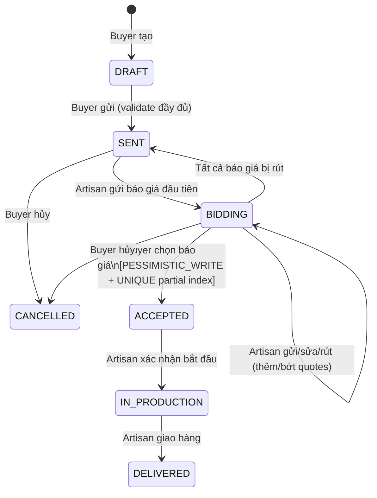
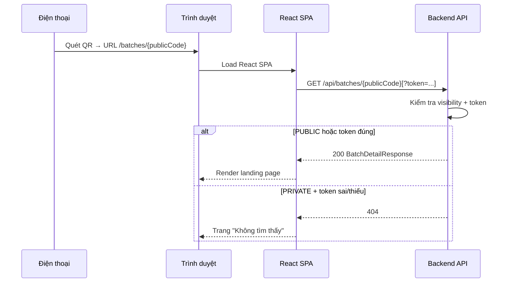
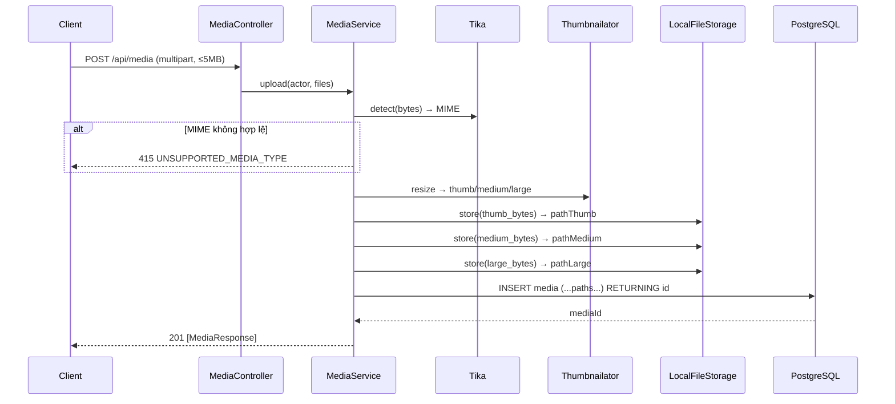
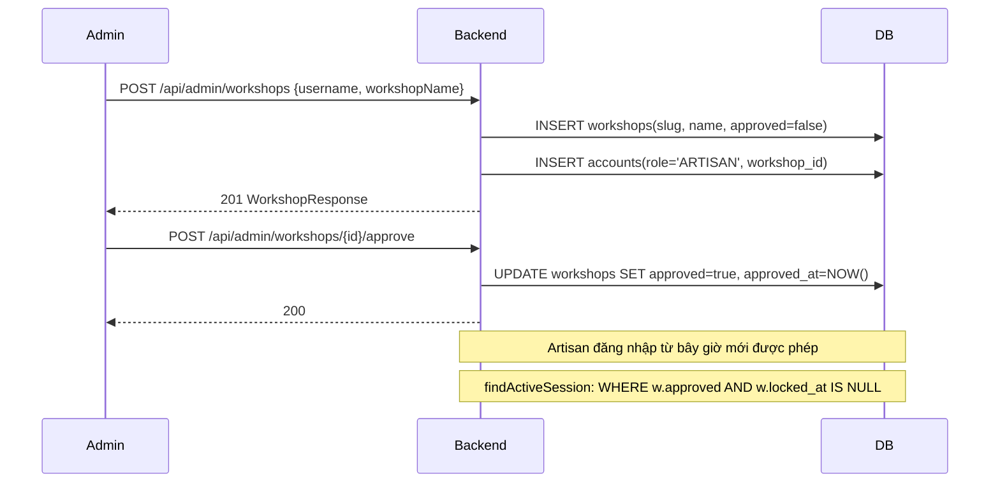

# vCraft Backend Blueprint — Tài liệu Thiết kế Chính thức
# INT3306 · Fall 2026 · Phiên bản 1.0

---

# PHẦN I — ARCHITECTURE REVIEW (Giai đoạn D)

## 1. Vấn đề phát hiện khi review — Phải sửa trước khi code

### 1.1. V5 đã bị ghi placeholder `SELECT 1`

**Vấn đề:** File `V5__expand_core.sql` đã tồn tại trong repo với nội dung `SELECT 1`. Flyway đã tính checksum file này. Nếu Flyway đã chạy file này trên môi trường nào đó (local dev), **không được sửa file V5 đó**. Phải xử lý theo một trong hai cách:

- **Nếu V5 chưa chạy trên DB nào (chỉ là file chờ):** Xóa nội dung placeholder, viết migration thật vào đúng file `V5__expand_core.sql`.
- **Nếu V5 đã chạy (flyway_schema_history có hàng V5):** Tạo file `V6__expand_core_real.sql` với toàn bộ nội dung schema mới; file news tạo thành `V7__news.sql`.

**Hành động:** Thắng kiểm tra bảng `flyway_schema_history` trong DB local:
```sql
SELECT version, description, success FROM flyway_schema_history ORDER BY installed_rank;
```
Nếu V5 chưa có hoặc `success = false` → ghi đè file V5. Nếu V5 đã thành công → đổi tên thành V6.

### 1.2. `accounts` dùng `GENERATED ALWAYS` — Không thể INSERT id tùy ý

**Vấn đề:** V3 tạo `accounts.id` với `GENERATED ALWAYS AS IDENTITY`. JPA với `GenerationType.IDENTITY` vẫn hoạt động, nhưng seed `ON CONFLICT DO NOTHING` sẽ lỗi nếu seed dùng id cụ thể.

**Hành động:** Seed phải dùng INSERT không có cột `id`, chỉ dùng `username` làm conflict key — **đã đúng trong code seed hiện tại**. Không cần thay đổi.

Với Entity `Account` (nếu tạo Entity JPA cho accounts sau này): dùng `@GeneratedValue(strategy = GenerationType.IDENTITY)` — Hibernate hiểu `GENERATED ALWAYS` tương đương.

### 1.3. `Workshop` Entity hiện tại chỉ có `id` và `name`

**Vấn đề nghiêm trọng:** `WorkshopRepository` dùng **JDBC thuần** (không phải JPA). Khi thêm cột vào bảng `workshops` qua migration, `ddl-auto=validate` **không** validate bảng không có Entity JPA. Điều này có nghĩa:

- Việc thêm cột `workshops` qua migration sẽ **không làm crash server**.
- Nhưng `Workshop.java` Entity đang thiếu phần lớn cột → nếu giữ nguyên JDBC repository thì không cần sửa Entity ngay.

**Quyết định sau review:** Giữ `WorkshopRepository` là JDBC (theo pattern hiện tại), mở rộng các query SQL thủ công. `Workshop.java` Entity chỉ cần đủ cột để `ddl-auto=validate` không phàn nàn — nhưng vì Workshop entity hiện không được dùng qua JPA (ProductRepository mới dùng JPA), workshop entity có thể để nguyên.

**Hành động cụ thể:** Thêm `@Column` annotation và cột mới vào `Workshop.java` Entity **sau khi** migration V5 đã chạy. Thứ tự bắt buộc: `migration chạy → Entity cập nhật → restart server`.

### 1.4. `Product` Entity thiếu `slug` field có getter đúng

**Vấn đề:** `Product.java` hiện có `private String slug` và `public String getSlug()` — OK. Nhưng `ProductRepository` dùng JPA và sẽ cần `findBySlug`. Khi thêm cột mới vào `products` (referencePrice, priceVisible...) phải thêm vào Entity JPA **đúng thứ tự**: migration trước, Entity sau.

### 1.5. `accounts` CHECK constraint quan trọng

V3 có: `CHECK ((role = 'ARTISAN') = (workshop_id IS NOT NULL))`

Điều này có nghĩa: **BUYER và ADMIN KHÔNG ĐƯỢC có workshop_id**. Migration V5 khi thêm cột vào `accounts` phải đảm bảo không vi phạm constraint này. Cột `email` nullable (ARTISAN không có email ở accounts, email của hộ ở `workshops.contact_email`).

### 1.6. `MaxUploadSizeExceededException` đã được xử lý trong `ApiErrors`

Tốt — không cần thêm. Nhưng cần thêm vào `application.properties`:
```properties
spring.servlet.multipart.max-file-size=5MB
spring.servlet.multipart.max-request-size=55MB
```

### 1.7. Không có test directory

**Vấn đề:** `/backend/src/test` không tồn tại. Các test trong `docs/03-engineering/testing.md` là script Postman/bash. Với bài tập lớn, chấp nhận kiểm thử qua Postman collection thay vì JUnit. Nhưng cần tạo ít nhất một integration test để CI pass nếu có pipeline.

**Hành động M4:** Tạo `src/test/java/.../SmokeTest.java` kiểm tra `/api/health` trả 200.

---

## 2. Kiểm tra Checklist — Architecture Review

| Tiêu chí | Kết quả | Ghi chú |
|---|---|---|
| Đáp ứng BTL_WEB? | ✅ | §4.1–4.4 đều có thiết kế đầy đủ |
| Phù hợp roadmap hiện tại? | ✅ | Giữ M1–M4, không đề xuất lại |
| Mâu thuẫn với code hiện tại? | ⚠️ | 7 vấn đề ở mục 1 — đều đã có hướng xử lý |
| Trùng lặp module? | ✅ Không | WorkshopService mở rộng, không viết lại |
| Thiếu API? | ✅ Không | 58 endpoint mới đã mô tả đầy đủ |
| Database toàn vẹn? | ✅ | FK, CHECK, UNIQUE đầy đủ |
| Lỗ hổng phân quyền? | ✅ Không | Mọi endpoint có role, ownership check ở Service |
| Xử lý concurrency? | ✅ | Quote dùng PESSIMISTIC_WRITE + UNIQUE partial index |
| Ảnh hưởng Frontend? | ⚠️ | 2 thay đổi nhỏ: endpoint artisan/workshop + product/{idOrSlug} |
| Đáp ứng tiêu chí chấm? | ✅ | Ánh xạ đầy đủ ở Phần VIII |

---

# PHẦN II — FINAL BACKEND BLUEPRINT

---

## A. STACK & CONSTRAINTS (Bất biến)

| Thành phần | Giá trị | Ghi chú |
|---|---|---|
| Java | 17 | Giữ nguyên |
| Spring Boot | 4.1.2 | Giữ nguyên |
| Spring Security | Bearer Token (không JWT) | ADR-0002 |
| DB | PostgreSQL 16 | Giữ nguyên |
| ORM | JPA (một số repo) + JDBC (một số repo) | Giữ nguyên pattern |
| Flyway | V1–V4 đã chạy; thêm V5, V6 | Không sửa V1–V4 |
| ddl-auto | validate | Entity phải khớp schema |
| Cấu trúc gói | Theo lớp (layer) | ADR — không theo module |
| Lưu ảnh | LocalFileStorage trên VPS | Q-13+Q-23 đã chốt |
| QR | ZXing (backend sinh PNG) | Q-20 đã chốt |
| Resize ảnh | Thumbnailator | Q-21 đã chốt |
| MIME validate | Apache Tika | Không tin Content-Type của client |
| OTP | JavaMail qua SMTP Gmail | Q-39 đã chốt |
| Deployment | Docker Compose + VPS | Q-23 đã chốt |

---

## B. MIGRATION PLAN (Thứ tự bắt buộc)

### Bước 0: Xử lý V5 placeholder (Thắng — làm đầu tiên)

```bash
# Kiểm tra DB:
psql -c "SELECT version, success FROM flyway_schema_history ORDER BY installed_rank;"

# Nếu V5 chưa có: ghi đè V5__expand_core.sql với nội dung thật
# Nếu V5 đã thành công: đổi tên sang V6__expand_core.sql, news sang V7__news.sql
```

### V5__expand_core.sql — Nội dung chính thức

```sql
-- =================================================================
-- V5: Mở rộng core tables + bảng mới cho M2
-- Kiểm tra V5 chưa chạy trước khi apply
-- =================================================================

-- 1. Mở rộng workshops
ALTER TABLE workshops
    ADD COLUMN description       TEXT,
    ADD COLUMN family_history    TEXT,
    ADD COLUMN address           VARCHAR(500),
    ADD COLUMN latitude          NUMERIC(10,7),
    ADD COLUMN longitude         NUMERIC(10,7),
    ADD COLUMN facebook_url      VARCHAR(500),
    ADD COLUMN approved_at       TIMESTAMPTZ,
    ADD COLUMN locked_at         TIMESTAMPTZ,
    ADD COLUMN locked_reason     VARCHAR(500),
    ADD COLUMN featured          BOOLEAN NOT NULL DEFAULT FALSE,
    ADD COLUMN cover_media_id    BIGINT,
    ADD COLUMN accepts_visitors  BOOLEAN NOT NULL DEFAULT FALSE,
    ADD COLUMN created_at        TIMESTAMPTZ NOT NULL DEFAULT NOW(),
    ADD COLUMN updated_at        TIMESTAMPTZ NOT NULL DEFAULT NOW();

CREATE INDEX workshops_approved_idx ON workshops(approved, id);
CREATE INDEX workshops_featured_idx ON workshops(featured) WHERE featured = TRUE;
CREATE INDEX workshops_latlon_idx   ON workshops(latitude, longitude)
    WHERE latitude IS NOT NULL AND longitude IS NOT NULL;

-- 2. Mở rộng accounts — email chỉ bắt buộc với BUYER
ALTER TABLE accounts
    ADD COLUMN display_name        VARCHAR(160),
    ADD COLUMN email               VARCHAR(254) UNIQUE,
    ADD COLUMN phone               VARCHAR(30),
    ADD COLUMN email_verified_at   TIMESTAMPTZ,
    ADD COLUMN created_at          TIMESTAMPTZ NOT NULL DEFAULT NOW();

-- 3. Bảng OTP email
CREATE TABLE email_otps (
    id          BIGINT GENERATED BY DEFAULT AS IDENTITY PRIMARY KEY,
    account_id  BIGINT NOT NULL REFERENCES accounts(id) ON DELETE CASCADE,
    otp_hash    CHAR(64) NOT NULL,
    purpose     VARCHAR(30) NOT NULL CHECK (purpose IN ('EMAIL_VERIFY','PASSWORD_RESET')),
    expires_at  TIMESTAMPTZ NOT NULL,
    used_at     TIMESTAMPTZ,
    created_at  TIMESTAMPTZ NOT NULL DEFAULT NOW()
);
CREATE INDEX email_otps_account_idx ON email_otps(account_id, purpose);

-- 4. Bảng media
CREATE TABLE media (
    id               BIGINT GENERATED BY DEFAULT AS IDENTITY PRIMARY KEY,
    owner_account_id BIGINT NOT NULL REFERENCES accounts(id),
    original_name    VARCHAR(255) NOT NULL,
    content_type     VARCHAR(60)  NOT NULL
                     CHECK (content_type IN ('image/jpeg','image/png','image/webp')),
    size_bytes       INTEGER NOT NULL CHECK (size_bytes > 0),
    width            INTEGER CHECK (width > 0),
    height           INTEGER CHECK (height > 0),
    path_thumb       VARCHAR(500) NOT NULL,
    path_medium      VARCHAR(500) NOT NULL,
    path_large       VARCHAR(500) NOT NULL,
    created_at       TIMESTAMPTZ NOT NULL DEFAULT NOW()
);
CREATE INDEX media_owner_idx ON media(owner_account_id);

-- 5. Gắn ảnh vào thực thể
CREATE TABLE media_links (
    media_id    BIGINT NOT NULL REFERENCES media(id) ON DELETE CASCADE,
    entity_type VARCHAR(30) NOT NULL
                CHECK (entity_type IN (
                    'WORKSHOP','PRODUCT','PROCESS_STEP',
                    'BATCH','BATCH_MILESTONE','CERTIFICATE','NEWS')),
    entity_id   BIGINT NOT NULL,
    position    SMALLINT NOT NULL DEFAULT 0,
    PRIMARY KEY (media_id, entity_type, entity_id)
);
CREATE INDEX media_links_entity_idx ON media_links(entity_type, entity_id, position);

-- FK cover_media_id sau khi media tồn tại
ALTER TABLE workshops
    ADD CONSTRAINT fk_workshop_cover
    FOREIGN KEY (cover_media_id) REFERENCES media(id) ON DELETE SET NULL;

-- 6. Chứng nhận
CREATE TABLE certificates (
    id          BIGINT GENERATED BY DEFAULT AS IDENTITY PRIMARY KEY,
    workshop_id BIGINT NOT NULL REFERENCES workshops(id) ON DELETE CASCADE,
    name        VARCHAR(200) NOT NULL,
    issuer      VARCHAR(200),
    issued_on   DATE,
    created_at  TIMESTAMPTZ NOT NULL DEFAULT NOW()
);
CREATE INDEX certificates_workshop_idx ON certificates(workshop_id);

-- 7. Giờ mở cửa (Q-29: theo thứ trong tuần)
CREATE TABLE workshop_hours (
    id          BIGINT GENERATED BY DEFAULT AS IDENTITY PRIMARY KEY,
    workshop_id BIGINT NOT NULL REFERENCES workshops(id) ON DELETE CASCADE,
    day_of_week SMALLINT NOT NULL CHECK (day_of_week BETWEEN 0 AND 6),
    open_time   TIME NOT NULL,
    close_time  TIME NOT NULL,
    CHECK (open_time < close_time),
    UNIQUE (workshop_id, day_of_week)
);

CREATE TABLE workshop_closures (
    id          BIGINT GENERATED BY DEFAULT AS IDENTITY PRIMARY KEY,
    workshop_id BIGINT NOT NULL REFERENCES workshops(id) ON DELETE CASCADE,
    closed_on   DATE NOT NULL,
    reason      VARCHAR(200),
    UNIQUE (workshop_id, closed_on)
);

-- 8. Mở rộng products
ALTER TABLE products
    ADD COLUMN reference_price NUMERIC(15,2) CHECK (reference_price > 0),
    ADD COLUMN price_visible   BOOLEAN NOT NULL DEFAULT TRUE,
    ADD COLUMN hidden          BOOLEAN NOT NULL DEFAULT FALSE,
    ADD COLUMN featured        BOOLEAN NOT NULL DEFAULT FALSE,
    ADD COLUMN created_at      TIMESTAMPTZ NOT NULL DEFAULT NOW(),
    ADD COLUMN updated_at      TIMESTAMPTZ NOT NULL DEFAULT NOW();

CREATE INDEX products_workshop_hidden_idx ON products(workshop_id, hidden, id);
CREATE INDEX products_category_hidden_idx ON products(category_id, hidden, id);
CREATE INDEX products_featured_idx        ON products(featured) WHERE featured = TRUE;

-- Full-text search sản phẩm (đơn giản)
CREATE INDEX products_name_search_idx ON products
    USING gin(to_tsvector('simple', name));

-- 9. Công đoạn sản xuất
CREATE TABLE process_steps (
    id          BIGINT GENERATED BY DEFAULT AS IDENTITY PRIMARY KEY,
    product_id  BIGINT NOT NULL REFERENCES products(id) ON DELETE CASCADE,
    position    SMALLINT NOT NULL CHECK (position >= 0),
    name        VARCHAR(200) NOT NULL,
    description TEXT,
    UNIQUE (product_id, position)
);
CREATE INDEX process_steps_product_idx ON process_steps(product_id, position);

-- 10. Lô hàng
CREATE TABLE batches (
    id              BIGINT GENERATED BY DEFAULT AS IDENTITY PRIMARY KEY,
    product_id      BIGINT NOT NULL REFERENCES products(id),
    workshop_id     BIGINT NOT NULL REFERENCES workshops(id),
    code            VARCHAR(120) NOT NULL,
    public_code     VARCHAR(32)  NOT NULL UNIQUE,
    name            VARCHAR(200),
    description     TEXT,
    kind            VARCHAR(20) NOT NULL CHECK (kind IN ('IN_STOCK','MADE_TO_ORDER')),
    quantity        INTEGER CHECK (quantity > 0),
    unit            VARCHAR(40),
    reference_price NUMERIC(15,2) CHECK (reference_price > 0),
    price_visible   BOOLEAN NOT NULL DEFAULT TRUE,
    supply_capacity VARCHAR(200),
    available_from  DATE,
    visibility      VARCHAR(10) NOT NULL DEFAULT 'PUBLIC'
                    CHECK (visibility IN ('PUBLIC','PRIVATE')),
    share_token     VARCHAR(64) UNIQUE,
    partner_note    TEXT,
    hidden          BOOLEAN NOT NULL DEFAULT FALSE,
    featured        BOOLEAN NOT NULL DEFAULT FALSE,
    created_at      TIMESTAMPTZ NOT NULL DEFAULT NOW(),
    updated_at      TIMESTAMPTZ NOT NULL DEFAULT NOW()
);
CREATE INDEX batches_product_idx    ON batches(product_id, visibility, hidden);
CREATE INDEX batches_workshop_idx   ON batches(workshop_id, visibility, hidden);

-- 11. Mốc sản xuất
CREATE TABLE batch_milestones (
    id              BIGINT GENERATED BY DEFAULT AS IDENTITY PRIMARY KEY,
    batch_id        BIGINT NOT NULL REFERENCES batches(id) ON DELETE CASCADE,
    process_step_id BIGINT REFERENCES process_steps(id) ON DELETE SET NULL,
    title           VARCHAR(200) NOT NULL,
    note            TEXT,
    happened_on     DATE NOT NULL,
    created_at      TIMESTAMPTZ NOT NULL DEFAULT NOW()
);
CREATE INDEX batch_milestones_batch_idx ON batch_milestones(batch_id, happened_on);

-- 12. Seed 12 tag gốm Bát Tràng (idempotent)
INSERT INTO tags (slug, name) VALUES
    ('gom-su', 'Gốm sứ'),
    ('bat-trang', 'Bát Tràng'),
    ('trang-tri', 'Trang trí'),
    ('gia-dung', 'Gia dụng'),
    ('qua-tang', 'Quà tặng'),
    ('thu-cong', 'Thủ công'),
    ('truyen-thong', 'Truyền thống'),
    ('hien-dai', 'Hiện đại'),
    ('men-xanh', 'Men xanh'),
    ('men-trang', 'Men trắng'),
    ('dat-nung', 'Đất nung'),
    ('co-lon', 'Cỡ lớn')
ON CONFLICT (slug) DO NOTHING;
```

### V6__news.sql

```sql
-- =================================================================
-- V6: News posts
-- =================================================================
CREATE TABLE news_posts (
    id                BIGINT GENERATED BY DEFAULT AS IDENTITY PRIMARY KEY,
    author_account_id BIGINT NOT NULL REFERENCES accounts(id),
    slug              VARCHAR(200) NOT NULL UNIQUE,
    title             VARCHAR(300) NOT NULL,
    body              TEXT NOT NULL,
    kind              VARCHAR(20) NOT NULL
                      CHECK (kind IN ('MATERIAL_PRICE','POWER_CUT','POLICY','EVENT','OTHER')),
    event_start       TIMESTAMPTZ,
    event_end         TIMESTAMPTZ,
    event_place       VARCHAR(300),
    hidden            BOOLEAN NOT NULL DEFAULT FALSE,
    published_at      TIMESTAMPTZ,
    created_at        TIMESTAMPTZ NOT NULL DEFAULT NOW(),
    updated_at        TIMESTAMPTZ NOT NULL DEFAULT NOW()
);
CREATE INDEX news_posts_published_idx ON news_posts(published_at DESC)
    WHERE hidden = FALSE;
CREATE INDEX news_posts_kind_idx ON news_posts(kind, published_at DESC)
    WHERE hidden = FALSE;
```

---

## C. CẤU TRÚC GÓI CUỐI CÙNG

```
vn.vcraft.backend/
│
├── config/
│   ├── SecurityConfig.java          (sửa — thêm permitAll)
│   ├── CorsConfig.java              (MỚI)
│   └── MediaConfig.java             (MỚI — @Value bindings)
│
├── controller/
│   ├── AuthController.java          (sửa — +3 endpoints)
│   ├── BuyerController.java         (giữ nguyên)
│   ├── BuyerQuoteController.java    (giữ nguyên — đừng đụng vào)
│   ├── ArtisanQuoteController.java  (giữ nguyên — đừng đụng vào)
│   ├── ArtisanWorkshopController.java (sửa — +8 endpoints)
│   ├── ArtisanProductController.java  (MỚI)
│   ├── AdminWorkshopController.java   (sửa — +2 endpoints lock/unlock)
│   ├── AdminController.java           (MỚI — stats, tags, news, featured, hậu kiểm)
│   ├── WorkshopController.java        (MỚI — public)
│   ├── ProductController.java         (sửa — +slug, +filter, +steps)
│   ├── BatchController.java           (MỚI — public)
│   ├── ArtisanBatchController.java    (MỚI)
│   ├── MediaController.java           (MỚI)
│   ├── NewsController.java            (MỚI — public)
│   ├── QuoteOptionsController.java    (giữ nguyên)
│   └── HealthController.java          (giữ nguyên)
│
├── dto/
│   ├── [Giữ nguyên tất cả DTO hiện có]
│   ├── RegisterRequest.java           (MỚI)
│   ├── RegisterResponse.java          (MỚI)
│   ├── VerifyEmailRequest.java        (MỚI)
│   ├── ResendOtpRequest.java          (MỚI)
│   ├── WorkshopProfileInput.java      (MỚI)
│   ├── WorkshopHourInput.java         (MỚI)
│   ├── WorkshopClosureInput.java      (MỚI)
│   ├── WorkshopDetailResponse.java    (MỚI)
│   ├── WorkshopSummaryResponse.java   (MỚI)
│   ├── MapPinResponse.java            (MỚI)
│   ├── CertificateInput.java          (MỚI)
│   ├── CertificateResponse.java       (MỚI)
│   ├── ProductCreateInput.java        (MỚI)
│   ├── ProductUpdateInput.java        (MỚI)
│   ├── ProductDetailResponse.java     (MỚI)
│   ├── ProductSummaryResponse.java    (MỚI)
│   ├── StepInput.java                 (MỚI)
│   ├── StepResponse.java              (MỚI)
│   ├── BatchCreateInput.java          (MỚI)
│   ├── BatchUpdateInput.java          (MỚI)
│   ├── BatchDetailResponse.java       (MỚI)
│   ├── BatchSummaryResponse.java      (MỚI)
│   ├── MilestoneInput.java            (MỚI)
│   ├── MilestoneResponse.java         (MỚI)
│   ├── MediaResponse.java             (MỚI)
│   ├── NewsCreateInput.java           (MỚI)
│   ├── NewsResponse.java              (MỚI)
│   ├── AdminStatsResponse.java        (MỚI)
│   ├── FeaturedInput.java             (MỚI)
│   ├── LockInput.java                 (MỚI)
│   └── HomeResponse.java              (MỚI)
│
├── exception/
│   ├── ApiErrors.java               (giữ nguyên — đầy đủ rồi)
│   └── ApiException.java            (giữ nguyên)
│
├── model/
│   ├── Workshop.java                (sửa — thêm đủ cột V5)
│   ├── Product.java                 (sửa — thêm cột V5)
│   ├── Category.java                (giữ nguyên)
│   ├── QuoteRequest.java            (giữ nguyên)
│   ├── Quote.java                   (giữ nguyên)
│   ├── Actor.java                   (giữ nguyên)
│   ├── ProcessStep.java             (MỚI)
│   ├── Batch.java                   (MỚI)
│   ├── BatchMilestone.java          (MỚI)
│   ├── NewsPost.java                (MỚI)
│   └── EmailOtp.java                (MỚI — chỉ cần để validate; thực tế repo dùng JDBC)
│
├── repository/
│   ├── AccountRepository.java       (sửa — +createBuyer, +findEmailInfo, ...)
│   ├── WorkshopRepository.java      (sửa — +listPublic, +findBySlug, +mapPins, ...)
│   ├── ProductRepository.java       (sửa — +findBySlug, +findFiltered, ...)
│   ├── OtpRepository.java           (MỚI — JDBC)
│   ├── MediaRepository.java         (MỚI — JDBC)
│   ├── WorkshopHourRepository.java  (MỚI — JDBC)
│   ├── BatchRepository.java         (MỚI — JPA)
│   ├── NewsRepository.java          (MỚI — JPA)
│   ├── ProcessStepRepository.java   (MỚI — JPA)
│   └── [Giữ nguyên tất cả repo Quote]
│
├── security/
│   ├── BearerTokenFilter.java       (giữ nguyên)
│   ├── BearerTokens.java            (giữ nguyên)
│   └── SecurityErrorWriter.java     (giữ nguyên)
│
├── service/
│   ├── AuthService.java             (sửa — +register, +verifyEmail, +resendOtp)
│   ├── WorkshopService.java         (sửa — +listPublic, +updateProfile, ...)
│   ├── ProductService.java          (sửa — +create, +update, +hide, +updateSteps)
│   ├── QuoteRequestService.java     (sửa — +check email_verified)
│   ├── OtpService.java              (MỚI)
│   ├── MediaService.java            (MỚI)
│   ├── BatchService.java            (MỚI)
│   ├── NewsService.java             (MỚI)
│   ├── AdminService.java            (MỚI)
│   └── HomeService.java             (MỚI)
│
├── storage/
│   ├── MediaStorage.java            (MỚI — interface)
│   └── LocalFileStorage.java        (MỚI — impl VPS)
│
└── validation/
    ├── Utf8Bytes.java               (giữ nguyên)
    └── SlugUtils.java               (MỚI — static utility)
```

---

## D. API CONTRACT HOÀN CHỈNH

### Nhóm AUTH

| # | Method | Path | Role | Status | Mô tả |
|---|---|---|---|---|---|
| 1 | POST | /api/login | Public | ✅ Có | Đăng nhập |
| 2 | GET | /api/me | Auth | ✅ Có | Thông tin người dùng hiện tại |
| 3 | POST | /api/logout | Auth | ✅ Có | Đăng xuất |
| 4 | POST | /api/register | Public | 🆕 M1 | Đăng ký Buyer + gửi OTP |
| 5 | POST | /api/register/verify-email | Public | 🆕 M1 | Xác thực OTP email |
| 6 | POST | /api/register/resend-otp | Public | 🆕 M1 | Gửi lại OTP |

### Nhóm WORKSHOP — Public

| # | Method | Path | Role | Status | Mô tả |
|---|---|---|---|---|---|
| 7 | GET | /api/workshops | Public | 🆕 M2A | Danh sách hộ (phân trang) |
| 8 | GET | /api/workshops/map | Public | 🆕 M2A | Ghim bản đồ (tọa độ + tóm tắt) |
| 9 | GET | /api/workshops/{slug} | Public | 🆕 M2A | Hồ sơ hộ chi tiết |

### Nhóm WORKSHOP — ARTISAN

| # | Method | Path | Role | Status | Mô tả |
|---|---|---|---|---|---|
| 10 | GET | /api/artisan/workshop | ARTISAN | 🆕 M2A | Hồ sơ xưởng của mình |
| 11 | PUT | /api/artisan/workshop | ARTISAN | 🆕 M2A | Cập nhật hồ sơ đầy đủ |
| 12 | PATCH | /api/artisan/workshops/{id} | ARTISAN | ✅ Có | Đổi tên (giữ backward compat) |
| 13 | PATCH | /api/artisan/workshops/{id}/contact | ARTISAN | ✅ Có | Đổi email/phone (giữ compat) |
| 14 | PUT | /api/artisan/workshop/hours | ARTISAN | 🆕 M2A | Cập nhật giờ mở cửa (thay toàn bộ) |
| 15 | POST | /api/artisan/workshop/closures | ARTISAN | 🆕 M2A | Thêm ngày đóng cửa đột xuất |
| 16 | DELETE | /api/artisan/workshop/closures/{id} | ARTISAN | 🆕 M2A | Xóa ngày đóng cửa |
| 17 | GET | /api/artisan/workshop/certificates | ARTISAN | 🆕 M2A | Danh sách chứng nhận |
| 18 | POST | /api/artisan/workshop/certificates | ARTISAN | 🆕 M2A | Thêm chứng nhận |
| 19 | DELETE | /api/artisan/workshop/certificates/{id} | ARTISAN | 🆕 M2A | Xóa chứng nhận |

### Nhóm PRODUCT — Public

| # | Method | Path | Role | Status | Mô tả |
|---|---|---|---|---|---|
| 20 | GET | /api/products | Public | ✅ Có | Danh sách (mảng — backward compat) |
| 21 | GET | /api/products/page | Public | ✅ Mở rộng | Phân trang + filter (workshopId, categoryId, tagSlug, q) |
| 22 | GET | /api/products/{idOrSlug} | Public | ✅ Mở rộng | Chi tiết theo id hoặc slug |
| 23 | GET | /api/products/{slug}/steps | Public | 🆕 M2A | Công đoạn sản xuất |
| 24 | GET | /api/categories | Public | 🆕 M2A | Danh sách phân loại |
| 25 | GET | /api/tags | Public | 🆕 M2A | Danh sách tag |

### Nhóm PRODUCT — ARTISAN

| # | Method | Path | Role | Status | Mô tả |
|---|---|---|---|---|---|
| 26 | GET | /api/artisan/products | ARTISAN | 🆕 M2A | Sản phẩm của xưởng (kể cả ẩn) |
| 27 | POST | /api/artisan/products | ARTISAN | 🆕 M2A | Tạo sản phẩm mới |
| 28 | GET | /api/artisan/products/{id} | ARTISAN | 🆕 M2A | Chi tiết sản phẩm (đầy đủ) |
| 29 | PUT | /api/artisan/products/{id} | ARTISAN | 🆕 M2A | Cập nhật sản phẩm |
| 30 | DELETE | /api/artisan/products/{id} | ARTISAN | 🆕 M2A | Ẩn sản phẩm (không xóa DB) |
| 31 | PUT | /api/artisan/products/{id}/steps | ARTISAN | 🆕 M2A | Cập nhật công đoạn (thay toàn bộ) |
| 32 | PUT | /api/artisan/products/{id}/tags | ARTISAN | 🆕 M2A | Cập nhật tag (thay toàn bộ) |

### Nhóm BATCH — Public

| # | Method | Path | Role | Status | Mô tả |
|---|---|---|---|---|---|
| 33 | GET | /api/batches | Public | 🆕 M2B | Danh sách lô công khai |
| 34 | GET | /api/batches/{publicCode} | Public | 🆕 M2B | Landing page lô (`?token=` cho lô riêng tư) |
| 35 | GET | /api/batches/{publicCode}/qr.png | Public | 🆕 M2B | QR code PNG (chỉ lô PUBLIC) |

### Nhóm BATCH — ARTISAN

| # | Method | Path | Role | Status | Mô tả |
|---|---|---|---|---|---|
| 36 | GET | /api/artisan/batches | ARTISAN | 🆕 M2B | Tất cả lô của xưởng |
| 37 | POST | /api/artisan/batches | ARTISAN | 🆕 M2B | Tạo lô mới |
| 38 | GET | /api/artisan/batches/{id} | ARTISAN | 🆕 M2B | Chi tiết lô (kể cả riêng tư) |
| 39 | PUT | /api/artisan/batches/{id} | ARTISAN | 🆕 M2B | Cập nhật thông tin lô |
| 40 | PUT | /api/artisan/batches/{id}/milestones | ARTISAN | 🆕 M2B | Cập nhật mốc sản xuất |
| 41 | POST | /api/artisan/batches/{id}/share-token | ARTISAN | 🆕 M2B | Tạo liên kết riêng tư |
| 42 | DELETE | /api/artisan/batches/{id}/share-token | ARTISAN | 🆕 M2B | Thu hồi liên kết riêng tư |
| 43 | GET | /api/artisan/batches/{id}/qr.png | ARTISAN | 🆕 M2B | QR (kể cả lô riêng tư) |

### Nhóm MEDIA

| # | Method | Path | Role | Status | Mô tả |
|---|---|---|---|---|---|
| 44 | POST | /api/media | Auth (mọi role) | 🆕 M1 | Upload 1–10 ảnh |
| 45 | DELETE | /api/media/{id} | Auth (chủ sở hữu) | 🆕 M1 | Xóa ảnh chưa gắn thực thể |

### Nhóm QUOTE (giữ nguyên — không sửa)

| # | Method | Path | Role | Status |
|---|---|---|---|---|
| 46 | POST | /api/buyer/quote-requests | BUYER | ✅ |
| 47 | GET | /api/buyer/quote-requests | BUYER | ✅ |
| 48 | GET | /api/buyer/quote-requests/{id} | BUYER | ✅ |
| 49 | PUT | /api/buyer/quote-requests/{id} | BUYER | ✅ |
| 50 | DELETE | /api/buyer/quote-requests/{id} | BUYER | ✅ |
| 51 | POST | /api/buyer/quote-requests/{id}/send | BUYER | ✅ |
| 52 | POST | /api/buyer/quote-requests/{id}/cancel | BUYER | ✅ |
| 53 | GET | /api/buyer/quote-requests/{id}/quotes | BUYER | ✅ |
| 54 | GET | /api/buyer/quote-requests/{id}/events | BUYER | ✅ |
| 55 | POST | /api/buyer/quote-requests/{id}/quotes/{qId}/accept | BUYER | ✅ |
| 56 | GET | /api/artisan/quote-requests | ARTISAN | ✅ |
| 57 | GET | /api/artisan/quote-requests/{id} | ARTISAN | ✅ |
| 58 | GET | /api/artisan/quote-requests/{id}/quotes | ARTISAN | ✅ |
| 59 | GET | /api/artisan/quote-requests/{id}/events | ARTISAN | ✅ |
| 60 | POST | /api/artisan/quote-requests/{id}/quotes | ARTISAN | ✅ |
| 61 | GET | /api/artisan/quotes/{id} | ARTISAN | ✅ |
| 62 | PUT | /api/artisan/quotes/{id} | ARTISAN | ✅ |
| 63 | POST | /api/artisan/quotes/{id}/withdraw | ARTISAN | ✅ |
| 64 | POST | /api/artisan/quote-requests/{id}/start-production | ARTISAN | ✅ |
| 65 | POST | /api/artisan/quote-requests/{id}/deliver | ARTISAN | ✅ |
| 66 | GET | /api/quote-tags | Public | ✅ |
| 67 | GET | /api/quote-categories | Public | ✅ |

### Nhóm NEWS

| # | Method | Path | Role | Status | Mô tả |
|---|---|---|---|---|---|
| 68 | GET | /api/news | Public | 🆕 M3 | Danh sách tin đã đăng (`?kind=&page=`) |
| 69 | GET | /api/news/{slug} | Public | 🆕 M3 | Chi tiết tin |

### Nhóm ADMIN

| # | Method | Path | Role | Status | Mô tả |
|---|---|---|---|---|---|
| 70 | GET | /api/admin/workshops | ADMIN | ✅ Có | Danh sách hộ (tất cả) |
| 71 | POST | /api/admin/workshops | ADMIN | ✅ Có | Cấp tài khoản hộ mới |
| 72 | POST | /api/admin/workshops/{id}/approve | ADMIN | ✅ Có | Duyệt hộ |
| 73 | POST | /api/admin/workshops/{id}/lock | ADMIN | 🆕 M3 | Khóa hộ (ghi lý do) |
| 74 | POST | /api/admin/workshops/{id}/unlock | ADMIN | 🆕 M3 | Mở khóa hộ |
| 75 | GET | /api/admin/stats | ADMIN | 🆕 M3 | Thống kê tổng quan |
| 76 | GET | /api/admin/tags | ADMIN | 🆕 M3 | Danh sách tag |
| 77 | POST | /api/admin/tags | ADMIN | 🆕 M3 | Tạo tag mới |
| 78 | PUT | /api/admin/tags/{id} | ADMIN | 🆕 M3 | Sửa tag |
| 79 | DELETE | /api/admin/tags/{id} | ADMIN | 🆕 M3 | Xóa tag |
| 80 | POST | /api/admin/products/{id}/hide | ADMIN | 🆕 M3 | Hậu kiểm — ẩn sản phẩm |
| 81 | POST | /api/admin/batches/{id}/hide | ADMIN | 🆕 M3 | Hậu kiểm — ẩn lô |
| 82 | PUT | /api/admin/featured | ADMIN | 🆕 M3 | Đặt nội dung nổi bật |
| 83 | GET | /api/admin/news | ADMIN | 🆕 M3 | Danh sách tin (tất cả) |
| 84 | POST | /api/admin/news | ADMIN | 🆕 M3 | Tạo tin tức |
| 85 | PUT | /api/admin/news/{id} | ADMIN | 🆕 M3 | Sửa tin tức |
| 86 | DELETE | /api/admin/news/{id} | ADMIN | 🆕 M3 | Xóa tin tức |

### Nhóm HOME & HEALTH

| # | Method | Path | Role | Status | Mô tả |
|---|---|---|---|---|---|
| 87 | GET | /api/home | Public | 🆕 M3 | Dữ liệu trang chủ (featured + news mới) |
| 88 | GET | /api/health | Public | ✅ | Health check |
| 89 | GET | /api/health/db | Public | ✅ | DB health check |

**Tổng: 89 endpoints (67 mới, 22 đã có)**

---

## E. SECURITY MATRIX

### Phân quyền theo đối tượng

| Tài nguyên | GUEST | BUYER | ARTISAN (chủ) | ARTISAN (khác) | ADMIN |
|---|---|---|---|---|---|
| Danh sách hộ/sản phẩm | ✅ | ✅ | ✅ | ✅ | ✅ |
| Lô PUBLIC | ✅ | ✅ | ✅ | ✅ | ✅ |
| Lô PRIVATE (đúng token) | ✅ | ✅ | ✅ | ✅ | ✅ |
| Lô PRIVATE (sai/không token) | ❌ 404 | ❌ 404 | ✅ | ❌ 404 | ✅ |
| Giá ẩn (price_visible=false) | ❌ null | ❌ null | ✅ | ❌ null | ✅ |
| Sửa hồ sơ xưởng | ❌ | ❌ | ✅ | ❌ 403 | ❌ |
| Sửa sản phẩm | ❌ | ❌ | ✅ | ❌ 403 | ❌ |
| Sửa lô | ❌ | ❌ | ✅ | ❌ 403 | ❌ |
| Tạo quote request | ❌ | ✅ (email verified) | ❌ | ❌ | ❌ |
| Xem quote của buyer khác | ❌ | ❌ 404 | ❌ | ❌ | ❌ |
| Xem note báo giá của hộ khác | ❌ | ❌ | ❌ 404 | ❌ | ❌ |
| Khóa/duyệt hộ | ❌ | ❌ | ❌ | ❌ | ✅ |
| Ẩn nội dung (hậu kiểm) | ❌ | ❌ | ❌ | ❌ | ✅ |
| Thống kê | ❌ | ❌ | ❌ | ❌ | ✅ |
| Upload ảnh | ❌ | ✅ | ✅ | ✅ | ✅ |

### Các kiểm tra bắt buộc ở Service layer

```
// Mọi ARTISAN operation:
if (!resource.getWorkshopId().equals(actor.workshop())) throw 403;

// Mọi BUYER operation:
if (!resource.getBuyerAccountId().equals(actor.id())) throw 404; // không lộ tồn tại

// Lô riêng tư:
if ("PRIVATE".equals(batch.getVisibility()) && !token.equals(batch.getShareToken())) throw 404;

// Buyer chưa verify email:
if (!accounts.isEmailVerified(actor.id())) throw 403 EMAIL_NOT_VERIFIED;

// Hộ bị khóa (đã xử lý trong BearerTokenFilter):
// findActiveSession đã có điều kiện w.locked_at IS NULL → không cần check lại ở Service
```

---

## F. TRANSACTION STRATEGY

### Tổng hợp tất cả transaction có rủi ro

| Nghiệp vụ | Locking | Isolation | Rủi ro xử lý |
|---|---|---|---|
| Buyer chấp nhận báo giá | PESSIMISTIC_WRITE trên quote_requests | READ_COMMITTED | UNIQUE partial index `quotes_one_accepted_per_request` chặn 2 thread vượt qua |
| Artisan gửi báo giá | PESSIMISTIC_WRITE trên quote_requests | READ_COMMITTED | UNIQUE(request_id, workshop_id) chặn gửi hai lần |
| Sinh public_code batch | Retry + UNIQUE(public_code) | — | Vòng lặp tối đa 5 lần; sau đó ném exception |
| Thu hồi share_token | @Transactional thường | — | Không có race condition nguy hiểm; token cũ trả 404 ngay sau commit |
| Upload ảnh | @Transactional — lưu DB sau file | — | File mồ côi nếu DB fail; cleanup job định kỳ (không urgent cho bài tập) |
| Khóa hộ + thu hồi session | @Transactional | — | `revokeAllSessionsForWorkshop` trong cùng transaction |
| OTP verify | @Transactional — markUsed + markEmailVerified | — | `UPDATE ... WHERE used_at IS NULL` đảm bảo OTP chỉ dùng 1 lần |
| Sửa draft quote request | @Version (optimistic) | — | 409 STALE_DATA nếu version không khớp — đã có trong ApiErrors |

---

## G. PERFORMANCE GUIDELINES

| Quy tắc | Áp dụng ở đâu |
|---|---|
| Pagination tại DB | Tất cả danh sách: `Pageable` JPA hoặc `LIMIT/OFFSET` trong JDBC |
| Không trả ảnh large trong list | List response chỉ dùng `thumbUrl` (240px) |
| Không N+1 | WorkshopRepository.listPublic: JOIN trong 1 query; ProductRepository: `join fetch` |
| Index cho filter | Đã tạo đầy đủ trong V5: workshop_hidden_idx, category_hidden_idx, latlon_idx |
| Lazy load JPA | `@ManyToOne(fetch = FetchType.LAZY)` — đã có trong Product entity |
| QR cache | `Cache-Control: public, max-age=86400` trên `GET /batches/{code}/qr.png` |
| Ảnh tĩnh qua Nginx | Không qua Spring; Nginx alias `/data/media` |

---

## H. COMPOSE & DEPLOYMENT CONFIGURATION

### compose.yaml — Phiên bản hoàn chỉnh

```yaml
services:
  db:
    image: postgres:16-alpine
    environment:
      POSTGRES_DB: ${POSTGRES_DB:-vcraft}
      POSTGRES_USER: ${POSTGRES_USER:-vcraft}
      POSTGRES_PASSWORD: ${POSTGRES_PASSWORD:?Copy .env.example to .env}
    volumes:
      - catalog_data:/var/lib/postgresql/data
    healthcheck:
      test: ["CMD-SHELL", "pg_isready -U \"$$POSTGRES_USER\" -d \"$$POSTGRES_DB\""]
      interval: 3s
      timeout: 3s
      retries: 20

  backend:
    build: ./backend
    environment:
      SPRING_DATASOURCE_URL: jdbc:postgresql://db:5432/${POSTGRES_DB:-vcraft}
      SPRING_DATASOURCE_USERNAME: ${POSTGRES_USER:-vcraft}
      SPRING_DATASOURCE_PASSWORD: ${POSTGRES_PASSWORD:?}
      SPRING_PROFILES_ACTIVE: ${SPRING_PROFILES_ACTIVE:-local}
      APP_BASE_URL: ${APP_BASE_URL:-http://localhost:8080}
      APP_FRONTEND_URL: ${APP_FRONTEND_URL:-http://localhost:5173}
      MEDIA_STORAGE_PATH: /data/media
      CORS_ALLOWED_ORIGINS: ${APP_FRONTEND_URL:-http://localhost:5173}
      MAIL_USERNAME: ${MAIL_USERNAME:-}
      MAIL_PASSWORD: ${MAIL_PASSWORD:-}
      SPRING_MAIL_HOST: ${MAIL_HOST:-smtp.gmail.com}
      SPRING_MAIL_PORT: ${MAIL_PORT:-587}
      SPRING_SERVLET_MULTIPART_MAX_FILE_SIZE: 5MB
      SPRING_SERVLET_MULTIPART_MAX_REQUEST_SIZE: 55MB
    volumes:
      - media_data:/data/media          # ← THÊM MỚI
    depends_on:
      db:
        condition: service_healthy
    ports:
      - "127.0.0.1:${BACKEND_PORT:-8080}:8080"

  frontend:
    build: ./frontend
    volumes:
      - media_data:/data/media:ro       # ← Nginx đọc ảnh từ volume chung
    depends_on:
      - backend
    ports:
      - "127.0.0.1:${FRONTEND_PORT:-5173}:80"

volumes:
  catalog_data:
  media_data:                           # ← THÊM MỚI
```

### nginx.conf trong frontend container

```nginx
server {
    listen 80;

    # Phục vụ ảnh tĩnh — không qua Spring
    location /media/ {
        alias /data/media/;
        expires 30d;
        add_header Cache-Control "public, immutable";
        add_header X-Content-Type-Options nosniff;
    }

    # Proxy API sang backend
    location /api/ {
        proxy_pass http://backend:8080;
        proxy_set_header Host $host;
        proxy_set_header X-Real-IP $remote_addr;
        proxy_set_header X-Forwarded-For $proxy_add_x_forwarded_for;
        client_max_body_size 55M;
    }

    # React SPA — fallback về index.html
    location / {
        root /usr/share/nginx/html;
        try_files $uri $uri/ /index.html;
    }
}
```

### .env.example (thêm biến mới)

```dotenv
POSTGRES_DB=vcraft
POSTGRES_USER=vcraft
POSTGRES_PASSWORD=changeme

APP_BASE_URL=https://yourdomain.com
APP_FRONTEND_URL=https://yourdomain.com

MAIL_USERNAME=yourteam@gmail.com
MAIL_PASSWORD=your_app_password_16_chars

BACKEND_PORT=8080
FRONTEND_PORT=80
```

---

## I. ROADMAP TRIỂN KHAI — Phiên bản Cuối

### M1 — Nền tảng (Thắng · ~1 tuần)

**Mục tiêu:** Hệ thống sẵn sàng để M2 bắt đầu song song.

**Checklist:**
- [ ] Giải quyết V5 placeholder (kiểm tra flyway_schema_history)
- [ ] Viết V5__expand_core.sql chính thức (nội dung ở phần B)
- [ ] Viết V6__news.sql
- [ ] Chạy migration trên DB local — xác nhận không lỗi
- [ ] Cập nhật `Workshop.java` Entity — thêm cột mới vào, đảm bảo `ddl-auto=validate` không crash
- [ ] Cập nhật `Product.java` Entity — thêm 5 cột mới
- [ ] Thêm 4 dependency vào `pom.xml` (ZXing, Thumbnailator, Tika, Mail)
- [ ] Thêm `spring.servlet.multipart.*` vào application.properties
- [ ] Viết `CorsConfig.java`
- [ ] Cập nhật `SecurityConfig.java` (permitAll mở rộng)
- [ ] Viết `SlugUtils.java`
- [ ] Viết `MediaStorage` interface + `LocalFileStorage`
- [ ] Viết `MediaRepository` (JDBC)
- [ ] Viết `MediaService`
- [ ] Viết `MediaController`
- [ ] Viết `OtpRepository` (JDBC)
- [ ] Viết `OtpService`
- [ ] Mở rộng `AccountRepository` (+7 method)
- [ ] Mở rộng `AuthService` (+3 method)
- [ ] Mở rộng `AuthController` (+3 endpoint)
- [ ] Cập nhật `compose.yaml` (thêm media_data volume)
- [ ] Viết `nginx.conf` với /media/ alias

**Definition of Done M1:**
- POST /api/register → 201 + email OTP gửi được
- POST /api/register/verify-email → 200
- POST /api/media với ảnh JPEG → 201 + 3 URL
- GET /media/{path} → ảnh phục vụ được qua Nginx
- Buyer chưa verify → POST /api/buyer/quote-requests → 403 EMAIL_NOT_VERIFIED

---

### M2 — Ba luồng song song (Sau M1 · ~2 tuần)

#### Luồng A — Huy (Triển lãm)

**Checklist:**
- [ ] `WorkshopRepository.java` — thêm: listPublic, findBySlug, mapPins, updateProfile, addCertificate, deleteCertificate, updateHours
- [ ] `WorkshopHourRepository.java` (JDBC mới) — replaceHours, isOpenNow (UTC+7)
- [ ] `WorkshopService.java` — thêm: listPublic, getBySlug, mapPins, updateProfile, addClosure, deleteClosure, addCertificate, deleteCertificate
- [ ] `WorkshopController.java` (public mới)
- [ ] `ArtisanWorkshopController.java` — thêm 8 endpoints
- [ ] `ProductRepository.java` — thêm: findBySlugPublic, findFiltered (với filter params), findByWorkshopAll, existsBySlug
- [ ] `ProcessStepRepository.java` (JPA mới)
- [ ] `ProductService.java` — thêm: create, update, hide, updateSteps, updateTags, findBySlugPublic, findFiltered
- [ ] `ArtisanProductController.java` (mới)
- [ ] `ProductController.java` — sửa /{idOrSlug}, thêm filter params, thêm /{slug}/steps
- [ ] Toàn bộ DTO mới (WorkshopDetailResponse, WorkshopSummaryResponse, MapPinResponse, ProductDetailResponse, ProductSummaryResponse, StepResponse, StepInput, CertificateResponse, CertificateInput, WorkshopHourInput, WorkshopClosureInput, WorkshopProfileInput)
- [ ] Frontend: Trang chủ, Danh sách hộ, Hồ sơ hộ, Bản đồ, Danh sách sản phẩm, Chi tiết sản phẩm, Quản lý hồ sơ Artisan, Quản lý sản phẩm Artisan

**Definition of Done Luồng A:**
- GET /api/workshops?page=0&size=10 → danh sách phân trang
- GET /api/workshops/{slug} → hồ sơ đầy đủ với ảnh, chứng nhận, giờ mở cửa, openNow
- GET /api/workshops/map → ghim tọa độ, hiển thị được trên Leaflet
- GET /api/products?workshopId=1&categoryId=2 → lọc đúng
- GET /api/products/coc-men-lam → trả chi tiết theo slug
- Artisan cập nhật hồ sơ → reload trang thấy thay đổi
- Giá ẩn (price_visible=false) → referencePrice = null trong public response

#### Luồng B — Dương (Truy xuất + Bản đồ)

**Checklist:**
- [ ] `Batch.java` Entity (mới)
- [ ] `BatchMilestone.java` Entity (mới)
- [ ] `BatchRepository.java` (JPA — thêm findByPublicCode, existsByPublicCode, listPublicByWorkshop...)
- [ ] `BatchService.java` (mới — đầy đủ)
- [ ] `BatchController.java` (public — mới)
- [ ] `ArtisanBatchController.java` (mới)
- [ ] `ProcessStep.java` Entity (mới)
- [ ] Toàn bộ DTO Batch (BatchDetailResponse, BatchSummaryResponse, BatchCreateInput, BatchUpdateInput, MilestoneInput, MilestoneResponse)
- [ ] Frontend: Landing page lô (`/batches/:publicCode`), Quản lý lô Artisan, Bản đồ Leaflet
- [ ] Test: quét QR trên điện thoại thật

**Definition of Done Luồng B:**
- POST /api/artisan/batches → 201 + public_code sinh tự động
- GET /api/batches/{publicCode} → landing page đầy đủ (sản phẩm + xưởng + mốc + ảnh)
- GET /api/batches/{publicCode}/qr.png → PNG 300×300, quét được bằng điện thoại
- Lô PRIVATE: GET /api/batches/{code} → 404; GET /api/batches/{code}?token=X → 200
- POST /share-token → shareUrl; DELETE → token cũ → 404
- GET /api/artisan/batches/{id}/qr.png → QR với token trong URL (lô riêng tư)

#### Luồng C — Thắng (Frontend Quote — Backend đã xong)

**Checklist:**
- [ ] Thêm `isEmailVerified` check vào `QuoteRequestService.create()`
- [ ] Frontend: Trang Buyer tạo/gửi yêu cầu báo giá
- [ ] Frontend: Trang Buyer xem danh sách yêu cầu + báo giá nhận được
- [ ] Frontend: Trang Artisan inbox yêu cầu khớp
- [ ] Frontend: Trang Artisan gửi/sửa/rút báo giá
- [ ] Frontend: Trang Artisan cập nhật tiến độ (start-production, deliver)

**Definition of Done Luồng C:**
- Buyer tạo yêu cầu → Artisan phù hợp nhận được trong inbox
- Artisan gửi báo giá → Buyer thấy ngay
- Buyer chấp nhận → trạng thái ACCEPTED; chỉ 1 báo giá được chấp nhận (test 2 tab song song)
- Artisan cập nhật IN_PRODUCTION → Buyer thấy tiến độ

---

### M3 — Administration & Content (~1 tuần)

**Checklist:**
- [ ] `NewsPost.java` Entity
- [ ] `NewsRepository.java` (JPA)
- [ ] `NewsService.java`
- [ ] `NewsController.java` (public)
- [ ] `AdminService.java` (lock/unlock/stats/featured/hậu kiểm/tags)
- [ ] `AdminController.java` (mở rộng + mới)
- [ ] `HomeService.java` + `HomeController.java`
- [ ] `AccountRepository.revokeAllSessionsForWorkshop()` — dùng trong lockWorkshop
- [ ] Cập nhật `WorkshopService.approve()` — thêm `approved_at = NOW()`
- [ ] Frontend: Admin dashboard, quản lý hộ, tin tức, nổi bật, hậu kiểm

**Definition of Done M3:**
- Admin lock hộ → token hộ bị từ chối ngay lập tức (không cần đăng xuất)
- GET /api/admin/stats → trả count hộ/sản phẩm/lô/yêu cầu
- GET /api/home → trả featured + 5 tin mới nhất
- POST /api/admin/news với `publish: true` → tin hiển thị ở /api/news ngay

---

### M4 — Integration Testing & Demo (~1 tuần)

**Checklist test bắt buộc:**

**Security Tests:**
- [ ] Artisan A không sửa được sản phẩm của Artisan B → 403
- [ ] Artisan A không xem được quote note của Artisan B → 404
- [ ] Buyer A không xem được yêu cầu của Buyer B → 404
- [ ] Buyer chưa verify email → không tạo được quote → 403
- [ ] Lô PRIVATE: GET không có token → 404
- [ ] Upload ảnh 10MB → 413
- [ ] Upload file .pdf → 415

**Concurrency Tests:**
- [ ] Mở 2 tab, Buyer A chấp nhận báo giá X, Buyer A (tab khác) chấp nhận báo giá Y cùng lúc → 1 thành công, 1 nhận 409
- [ ] Artisan gửi báo giá 2 lần liên tiếp cùng request → lần 2 nhận 409

**Integration Tests:**
- [ ] Đăng ký Buyer → xác thực email OTP → đăng nhập → tạo yêu cầu báo giá
- [ ] Artisan tạo sản phẩm → tạo lô → upload ảnh → quét QR → xem landing page
- [ ] Admin duyệt hộ → hộ đăng nhập → cập nhật hồ sơ → hiển thị trên bản đồ
- [ ] Admin lock hộ → hộ gọi API ngay lập tức → 401 UNAUTHENTICATED

**Demo Script (chạy được trong 15 phút):**
1. Admin tạo hộ, duyệt hộ
2. Artisan đăng nhập, cập nhật hồ sơ, tọa độ
3. Artisan tạo sản phẩm, thêm công đoạn, gắn ảnh
4. Artisan tạo lô, thêm mốc, sinh QR
5. Khách quét QR → landing page
6. Buyer đăng ký, xác thực email
7. Buyer tạo yêu cầu báo giá (mở/có chỉ định)
8. Artisan nhận yêu cầu, gửi báo giá
9. Buyer chấp nhận báo giá
10. Artisan cập nhật IN_PRODUCTION → DELIVERED
11. Admin xem thống kê, đăng tin tức

---

## J. ÁNH XẠ TIÊU CHÍ CHẤM ĐIỂM

| Tiêu chí | Trọng số | Backend cần đáp ứng | Bằng chứng demo |
|---|---:|---|---|
| Chức năng | 35% | 89 endpoint; đủ 4 nghiệp vụ §4.1–4.4; state machine 7 trạng thái | Chạy full Demo Script 10 bước |
| Thiết kế Logic | 10% | Quote state machine, pessimistic lock, QR→landing page, public_code trong URL | Demo concurrent accept; quét QR điện thoại thật |
| Responsive/UI | 20% | API trả thumbUrl (không gửi large trong list); slug trong URL | Mở danh sách trên điện thoại; kiểm tra payload size |
| Hiệu năng | 10% | Pagination server-side; join fetch tránh N+1; index đầy đủ; ảnh tĩnh qua Nginx | Seed 200 sản phẩm; đo thời gian tải danh sách |
| Phong cách | 5% | Controller → Service → Repository → DTO; không trả Entity trực tiếp | Review code |
| Nhập liệu | 5% | Bean Validation @Valid; fieldErrors tiếng Việt; kiểm tra MIME ảnh | Gửi form sai → 400 kèm fieldErrors cụ thể |
| An ninh | 5% | BCrypt; token hash SHA-256; role guard; ownership check; upload MIME; locked_at check | Thử sai quyền → 403/404; thử upload PDF → 415 |
| URL | 5% | /workshops/{slug}; /products/{slug}; /batches/{publicCode}; /news/{slug} | Dán URL vào thanh địa chỉ — không 404 |
| CSDL | 5% | Flyway V1–V6; constraints; partial unique index; indexes đầy đủ | Xem migration files; EXPLAIN ANALYZE query |

---

## K. SƠ ĐỒ TỔNG QUAN

### K.1. Quote State Machine (giữ nguyên từ code)



### K.2. QR Resolution Flow



### K.3. Media Upload Flow



### K.4. Workshop Approval Flow



---

*Blueprint này là tài liệu thiết kế chính thức. Developer không cần đọc tài liệu nào khác để bắt đầu code. Mọi thay đổi so với Blueprint này phải được ghi chú rõ lý do.*
