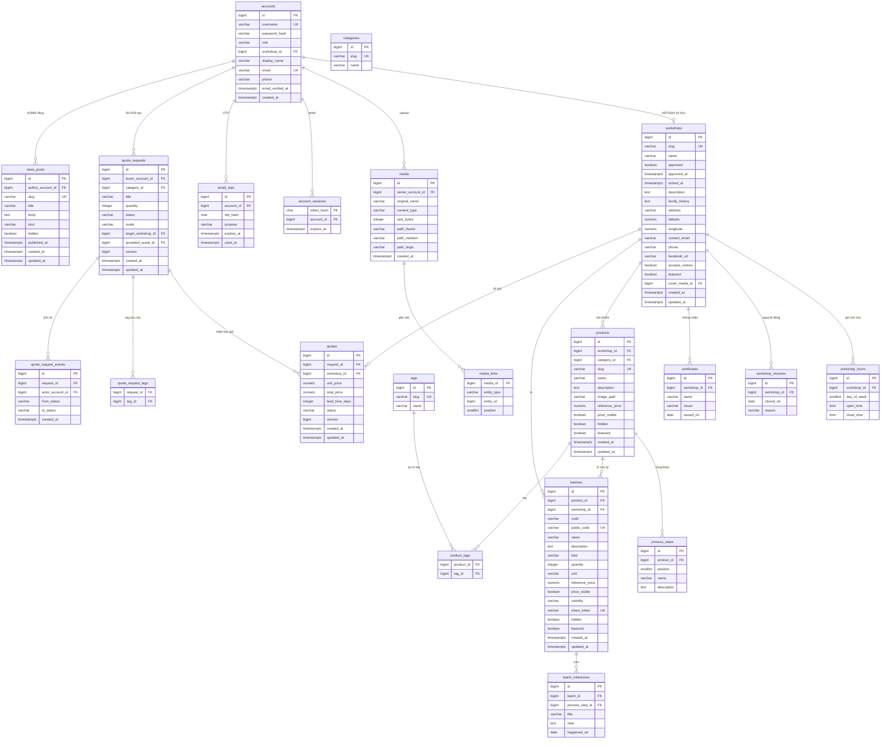

# GIAI ĐOẠN B — Backend Architecture Proposal
# vCraft · INT3306 Fall 2026

> Căn cứ: BTL_WEB.docx · vCraft-Quote-backend (V1–V4 đã chạy) · 8 câu xác nhận của nhóm ngày 2026-11-21.
> Mọi đề xuất giữ nguyên stack, cấu trúc gói, và tất cả API đã có (không phá vỡ hợp đồng cũ).

---

## PHẦN 1 — KIẾN TRÚC TỔNG THỂ

### 1.1. System Context

```
                        ┌─────────────────────────────────────────┐
                        │              INTERNET                     │
                        └─────────────────────────────────────────┘
                                           │
            ┌──────────────────────────────┼──────────────────────────────┐
            │                              │                               │
     ┌──────▼──────┐              ┌────────▼────────┐             ┌───────▼──────┐
     │  BROWSER    │              │   MOBILE QR     │             │  SMTP Gmail  │
     │ React SPA   │              │   Scanner       │             │  (OTP Buyer) │
     └──────┬──────┘              └────────┬────────┘             └───────┬──────┘
            │ HTTPS                        │ HTTPS                        │
            └──────────────────────────────┼──────────────────────────────┘
                                           │
                               ┌───────────▼───────────┐
                               │       NGINX            │
                               │  (reverse proxy +      │
                               │   static files)        │
                               └───────────┬────────────┘
                                           │
                               ┌───────────▼────────────┐
                               │   Spring Boot 4.1.2    │
                               │   Java 17 · Port 8080  │
                               │   (Backend API)        │
                               └───────────┬────────────┘
                                           │
                      ┌────────────────────┼────────────────────┐
                      │                    │                     │
           ┌──────────▼──────┐  ┌──────────▼──────┐  ┌────────▼────────┐
           │  PostgreSQL 16  │  │  Local Filesystem│  │  JavaMail SMTP  │
           │  Port 5432      │  │  (ảnh + biến thể)│  │  (OTP email)    │
           └─────────────────┘  └─────────────────┘  └─────────────────┘
```

**Deployment:** Docker Compose trên VPS · 4 container: `db`, `backend`, `frontend` (Nginx), `certbot`.

### 1.2. Backend Module Architecture

```
vn.vcraft.backend
├── config/           ← SecurityConfig, MailConfig (mới), MediaConfig (mới), CorsConfig (mới)
├── controller/       ← HTTP layer thuần; không chứa logic nghiệp vụ
│   ├── AuthController              (đã có)
│   ├── BuyerController             (đã có — mở rộng)
│   ├── BuyerQuoteController        (đã có — giữ nguyên)
│   ├── ArtisanQuoteController      (đã có — giữ nguyên)
│   ├── ArtisanWorkshopController   (đã có — mở rộng)
│   ├── AdminWorkshopController     (đã có — mở rộng)
│   ├── ProductController           (đã có — mở rộng)
│   ├── QuoteOptionsController      (đã có — giữ nguyên)
│   ├── WorkshopController          (MỚI — public)
│   ├── BatchController             (MỚI — public + artisan)
│   ├── MediaController             (MỚI)
│   ├── NewsController              (MỚI — public + admin)
│   ├── AdminController             (MỚI — stats, featured, hậu kiểm, tags)
│   ├── MapController               (MỚI — public)
│   └── HealthController            (đã có)
├── dto/              ← Record/class thuần; không dùng Entity ở đây
├── exception/        ← ApiErrors (đã có), ApiException (đã có)
├── model/            ← JPA Entity — phải khớp schema chính xác
├── repository/       ← JPA Repository + JDBC raw; không chứa logic nghiệp vụ
├── security/         ← BearerTokenFilter, BearerTokens (đã có)
├── service/          ← Toàn bộ nghiệp vụ: transaction, locking, validation nghiệp vụ
│   ├── AuthService              (đã có — mở rộng: đăng ký Buyer, OTP)
│   ├── WorkshopService          (đã có — mở rộng: hồ sơ đầy đủ)
│   ├── ProductService           (đã có — mở rộng: CRUD, slug, steps)
│   ├── BatchService             (MỚI)
│   ├── MediaService             (MỚI)
│   ├── QrService                (MỚI)
│   ├── QuoteRequestService      (đã có — giữ nguyên)
│   ├── NewsService              (MỚI)
│   ├── AdminService             (MỚI)
│   └── OtpService               (MỚI)
├── storage/          ← Interface + Local impl (MỚI — tách biệt khỏi MediaService)
│   ├── MediaStorage             (interface)
│   └── LocalFileStorage         (impl VPS)
└── validation/       ← Utf8Bytes (đã có), custom validators
```

**Nguyên tắc phân tầng (giữ nguyên):**
- Controller: nhận HTTP, validate DTO (@Valid), gọi Service, trả ResponseEntity.
- Service: @Transactional, kiểm quyền sở hữu, nghiệp vụ, gọi Repository.
- Repository: truy vấn dữ liệu thuần — JPA JPQL hoặc JDBC raw.
- Không Entity trong response; không logic trong Repository.

---

## PHẦN 2 — DATABASE ARCHITECTURE

### 2.1. Chiến lược Migration

| Migration | Nội dung | Người làm | Ưu tiên |
|---|---|---|---|
| **V1–V4** | ĐÃ CHẠY — không được sửa | — | — |
| **V5** | Mở rộng workshops, products, accounts; bảng process_steps, batches, batch_milestones, media, media_links, certificates | Thắng + Dương | P0 — làm đầu M2 |
| **V6** | Bảng news_posts, email_otps; bảng opening_hours | Thắng | P0 |
| **V7** | Bảng reports; thêm featured/nổi bật vào bảng config hoặc cột | Thắng | P2 |

**Quy tắc bất biến:**
- Không ALTER migration đã merge.
- Mỗi migration phải chạy được idempotent trên DB sạch.
- Cập nhật Entity trong cùng PR với migration.
- `ddl-auto=validate` → Entity phải khớp 100% schema sau migration.

### 2.2. Schema Đề Xuất — V5

```sql
-- =============================================
-- V5: Mở rộng + bảng mới cho M2 (Luồng A + B)
-- =============================================

-- 2.2.1. Mở rộng workshops
ALTER TABLE workshops
    ADD COLUMN description       TEXT,
    ADD COLUMN family_history    TEXT,
    ADD COLUMN address           VARCHAR(500),
    ADD COLUMN latitude          NUMERIC(10, 7),
    ADD COLUMN longitude         NUMERIC(10, 7),
    ADD COLUMN facebook_url      VARCHAR(500),
    ADD COLUMN approved_at       TIMESTAMPTZ,
    ADD COLUMN locked_at         TIMESTAMPTZ,          -- null = chưa khóa
    ADD COLUMN locked_reason     VARCHAR(500),
    ADD COLUMN featured          BOOLEAN NOT NULL DEFAULT FALSE,
    ADD COLUMN cover_media_id    BIGINT,               -- FK sau khi tạo bảng media
    ADD COLUMN accepts_visitors  BOOLEAN NOT NULL DEFAULT FALSE,
    ADD COLUMN created_at        TIMESTAMPTZ NOT NULL DEFAULT NOW(),
    ADD COLUMN updated_at        TIMESTAMPTZ NOT NULL DEFAULT NOW();

-- Index hỗ trợ danh sách hộ
CREATE INDEX workshops_approved_idx ON workshops(approved, id);
CREATE INDEX workshops_featured_idx ON workshops(featured) WHERE featured = TRUE;

-- 2.2.2. Giờ mở cửa (Q-29: giờ theo thứ trong tuần + ngoại lệ)
-- Tách bảng riêng để linh hoạt; hộ có thể không khai giờ
CREATE TABLE workshop_hours (
    id          BIGINT GENERATED BY DEFAULT AS IDENTITY PRIMARY KEY,
    workshop_id BIGINT NOT NULL REFERENCES workshops(id) ON DELETE CASCADE,
    day_of_week SMALLINT NOT NULL CHECK (day_of_week BETWEEN 0 AND 6), -- 0=CN, 1=T2…6=T7
    open_time   TIME NOT NULL,
    close_time  TIME NOT NULL,
    CHECK (open_time < close_time),
    UNIQUE (workshop_id, day_of_week)
);
-- Ngoại lệ: đóng cửa đột xuất (Tết, sửa chữa…)
CREATE TABLE workshop_closures (
    id          BIGINT GENERATED BY DEFAULT AS IDENTITY PRIMARY KEY,
    workshop_id BIGINT NOT NULL REFERENCES workshops(id) ON DELETE CASCADE,
    closed_on   DATE NOT NULL,
    reason      VARCHAR(200),
    UNIQUE (workshop_id, closed_on)
);

-- 2.2.3. Mở rộng accounts (đăng ký Buyer + xác thực OTP)
ALTER TABLE accounts
    ADD COLUMN display_name        VARCHAR(160),
    ADD COLUMN email               VARCHAR(254) UNIQUE,
    ADD COLUMN phone               VARCHAR(30),
    ADD COLUMN email_verified_at   TIMESTAMPTZ,
    ADD COLUMN created_at          TIMESTAMPTZ NOT NULL DEFAULT NOW();

-- Artisan không có email trên accounts (email xưởng ở workshops)
-- Buyer bắt buộc có email

-- 2.2.4. Bảng OTP email
CREATE TABLE email_otps (
    id          BIGINT GENERATED BY DEFAULT AS IDENTITY PRIMARY KEY,
    account_id  BIGINT NOT NULL REFERENCES accounts(id) ON DELETE CASCADE,
    otp_hash    CHAR(64) NOT NULL,                   -- SHA-256 của 6 chữ số
    purpose     VARCHAR(30) NOT NULL CHECK(purpose IN ('EMAIL_VERIFY','PASSWORD_RESET')),
    expires_at  TIMESTAMPTZ NOT NULL,
    used_at     TIMESTAMPTZ,
    created_at  TIMESTAMPTZ NOT NULL DEFAULT NOW()
);
CREATE INDEX email_otps_account_idx ON email_otps(account_id, purpose);

-- 2.2.5. Bảng media (ảnh đã upload)
CREATE TABLE media (
    id              BIGINT GENERATED BY DEFAULT AS IDENTITY PRIMARY KEY,
    owner_account_id BIGINT NOT NULL REFERENCES accounts(id),
    original_name   VARCHAR(255) NOT NULL,
    content_type    VARCHAR(60) NOT NULL CHECK(content_type IN ('image/jpeg','image/png','image/webp')),
    size_bytes      INTEGER NOT NULL CHECK(size_bytes > 0),
    width           INTEGER,
    height          INTEGER,
    path_thumb      VARCHAR(500) NOT NULL,     -- 240px
    path_medium     VARCHAR(500) NOT NULL,     -- 800px
    path_large      VARCHAR(500) NOT NULL,     -- 1600px
    created_at      TIMESTAMPTZ NOT NULL DEFAULT NOW()
);

-- 2.2.6. Bảng gắn ảnh vào thực thể
CREATE TABLE media_links (
    media_id    BIGINT NOT NULL REFERENCES media(id) ON DELETE CASCADE,
    entity_type VARCHAR(30) NOT NULL CHECK(entity_type IN (
                    'WORKSHOP','PRODUCT','PROCESS_STEP','BATCH',
                    'BATCH_MILESTONE','CERTIFICATE','NEWS','QUOTE_REQUEST')),
    entity_id   BIGINT NOT NULL,
    position    SMALLINT NOT NULL DEFAULT 0,         -- 0 = ảnh bìa
    PRIMARY KEY (media_id, entity_type, entity_id)
);
CREATE INDEX media_links_entity_idx ON media_links(entity_type, entity_id, position);

-- FK ngược từ workshops về media (sau khi media tồn tại)
ALTER TABLE workshops
    ADD CONSTRAINT fk_workshop_cover FOREIGN KEY (cover_media_id) REFERENCES media(id) ON DELETE SET NULL;

-- 2.2.7. Chứng nhận chất lượng
CREATE TABLE certificates (
    id          BIGINT GENERATED BY DEFAULT AS IDENTITY PRIMARY KEY,
    workshop_id BIGINT NOT NULL REFERENCES workshops(id) ON DELETE CASCADE,
    name        VARCHAR(200) NOT NULL,
    issuer      VARCHAR(200),
    issued_on   DATE,
    created_at  TIMESTAMPTZ NOT NULL DEFAULT NOW()
);
-- Ảnh chứng nhận qua media_links WHERE entity_type='CERTIFICATE'

-- 2.2.8. Mở rộng products
ALTER TABLE products
    ADD COLUMN reference_price  NUMERIC(15,2) CHECK(reference_price > 0),
    ADD COLUMN price_visible    BOOLEAN NOT NULL DEFAULT TRUE,
    ADD COLUMN hidden           BOOLEAN NOT NULL DEFAULT FALSE,
    ADD COLUMN featured         BOOLEAN NOT NULL DEFAULT FALSE,
    ADD COLUMN created_at       TIMESTAMPTZ NOT NULL DEFAULT NOW(),
    ADD COLUMN updated_at       TIMESTAMPTZ NOT NULL DEFAULT NOW();

-- Index lọc sản phẩm
CREATE INDEX products_workshop_idx ON products(workshop_id, hidden, id);
CREATE INDEX products_category_idx ON products(category_id, hidden, id);
CREATE INDEX products_featured_idx ON products(featured) WHERE featured = TRUE;

-- 2.2.9. Công đoạn sản xuất (dùng chung cho sản phẩm)
CREATE TABLE process_steps (
    id          BIGINT GENERATED BY DEFAULT AS IDENTITY PRIMARY KEY,
    product_id  BIGINT NOT NULL REFERENCES products(id) ON DELETE CASCADE,
    position    SMALLINT NOT NULL CHECK(position >= 0),
    name        VARCHAR(200) NOT NULL,
    description TEXT,
    UNIQUE (product_id, position)
);
CREATE INDEX process_steps_product_idx ON process_steps(product_id, position);

-- 2.2.10. Lô hàng
CREATE TABLE batches (
    id              BIGINT GENERATED BY DEFAULT AS IDENTITY PRIMARY KEY,
    product_id      BIGINT NOT NULL REFERENCES products(id),
    workshop_id     BIGINT NOT NULL REFERENCES workshops(id),  -- dư nhưng cần để query nhanh
    code            VARCHAR(120) NOT NULL,
    public_code     VARCHAR(32)  NOT NULL UNIQUE,              -- URL-safe random, dùng trong QR
    name            VARCHAR(200),
    description     TEXT,
    kind            VARCHAR(20)  NOT NULL CHECK(kind IN ('IN_STOCK','MADE_TO_ORDER')),
    quantity        INTEGER      CHECK(quantity > 0),
    unit            VARCHAR(40),
    reference_price NUMERIC(15,2) CHECK(reference_price > 0),
    price_visible   BOOLEAN NOT NULL DEFAULT TRUE,
    supply_capacity VARCHAR(200),
    available_from  DATE,
    visibility      VARCHAR(10)  NOT NULL DEFAULT 'PUBLIC' CHECK(visibility IN ('PUBLIC','PRIVATE')),
    share_token     VARCHAR(64)  UNIQUE,                       -- null = không có liên kết riêng
    partner_note    TEXT,
    hidden          BOOLEAN NOT NULL DEFAULT FALSE,
    featured        BOOLEAN NOT NULL DEFAULT FALSE,
    created_at      TIMESTAMPTZ NOT NULL DEFAULT NOW(),
    updated_at      TIMESTAMPTZ NOT NULL DEFAULT NOW()
);
CREATE INDEX batches_product_idx    ON batches(product_id, visibility, hidden);
CREATE INDEX batches_workshop_idx   ON batches(workshop_id, visibility);
CREATE INDEX batches_public_code_idx ON batches(public_code);  -- đã có UNIQUE nhưng thêm rõ

-- 2.2.11. Mốc sản xuất của lô
CREATE TABLE batch_milestones (
    id              BIGINT GENERATED BY DEFAULT AS IDENTITY PRIMARY KEY,
    batch_id        BIGINT NOT NULL REFERENCES batches(id) ON DELETE CASCADE,
    process_step_id BIGINT REFERENCES process_steps(id) ON DELETE SET NULL,  -- nullable
    title           VARCHAR(200) NOT NULL,
    note            TEXT,
    happened_on     DATE NOT NULL,
    created_at      TIMESTAMPTZ NOT NULL DEFAULT NOW()
);
CREATE INDEX batch_milestones_batch_idx ON batch_milestones(batch_id, happened_on);
```

### 2.3. Schema V6

```sql
-- =============================================
-- V6: News + Admin stats config
-- =============================================

CREATE TABLE news_posts (
    id               BIGINT GENERATED BY DEFAULT AS IDENTITY PRIMARY KEY,
    author_account_id BIGINT NOT NULL REFERENCES accounts(id),
    slug             VARCHAR(200) NOT NULL UNIQUE,
    title            VARCHAR(300) NOT NULL,
    body             TEXT NOT NULL,
    kind             VARCHAR(20) NOT NULL CHECK(kind IN (
                         'MATERIAL_PRICE','POWER_CUT','POLICY','EVENT','OTHER')),
    event_start      TIMESTAMPTZ,
    event_end        TIMESTAMPTZ,
    event_place      VARCHAR(300),
    hidden           BOOLEAN NOT NULL DEFAULT FALSE,
    published_at     TIMESTAMPTZ,                    -- NULL = còn nháp
    created_at       TIMESTAMPTZ NOT NULL DEFAULT NOW(),
    updated_at       TIMESTAMPTZ NOT NULL DEFAULT NOW()
);
CREATE INDEX news_posts_published_idx ON news_posts(published_at DESC) WHERE hidden = FALSE;
CREATE INDEX news_posts_kind_idx      ON news_posts(kind, published_at DESC);
```

### 2.4. Schema V7 (P2)

```sql
-- =============================================
-- V7: Reports (P2 — làm nếu còn thời gian)
-- =============================================
CREATE TABLE reports (
    id                 BIGINT GENERATED BY DEFAULT AS IDENTITY PRIMARY KEY,
    reporter_account_id BIGINT REFERENCES accounts(id) ON DELETE SET NULL,
    entity_type        VARCHAR(30) NOT NULL CHECK(entity_type IN ('PRODUCT','BATCH','NEWS')),
    entity_id          BIGINT NOT NULL,
    reason             VARCHAR(500) NOT NULL,
    status             VARCHAR(10) NOT NULL DEFAULT 'OPEN' CHECK(status IN ('OPEN','RESOLVED')),
    created_at         TIMESTAMPTZ NOT NULL DEFAULT NOW()
);
```

### 2.5. ERD Toàn Hệ Thống (Mermaid)



---

## PHẦN 3 — API ARCHITECTURE

### 3.1. Tổng bảng API (tất cả module)

#### Nhóm AUTH (mở rộng từ cái đã có)

| Method | Path | Role | Trạng thái | FR |
|---|---|---|---|---|
| POST | /api/login | Public | ✅ Có | — |
| GET | /api/me | Auth | ✅ Có | — |
| POST | /api/logout | Auth | ✅ Có | — |
| POST | /api/register | Public | 🆕 Mới | FR-AUTH-04 |
| POST | /api/register/verify-email | Public | 🆕 Mới | FR-AUTH-04 |
| POST | /api/register/resend-otp | Public | 🆕 Mới | FR-AUTH-04 |

#### Nhóm WORKSHOP — Public

| Method | Path | Role | Trạng thái | FR |
|---|---|---|---|---|
| GET | /api/workshops?q=&page= | Public | 🆕 Mới | FR-WS-06 |
| GET | /api/workshops/{slug} | Public | 🆕 Mới | FR-WS-01,07 |
| GET | /api/workshops/map | Public | 🆕 Mới | FR-MAP-01,02,03 |

#### Nhóm WORKSHOP — ARTISAN (mở rộng)

| Method | Path | Role | Trạng thái | FR |
|---|---|---|---|---|
| GET | /api/artisan/workshop | ARTISAN | 🆕 Mới | FR-WS-02 |
| PUT | /api/artisan/workshop | ARTISAN | 🔄 Thay PATCH/{id} | FR-WS-02,04,05 |
| PUT | /api/artisan/workshop/hours | ARTISAN | 🆕 Mới | FR-WS-05 (Q-29) |
| POST | /api/artisan/workshop/closures | ARTISAN | 🆕 Mới | FR-WS-05 |
| DELETE | /api/artisan/workshop/closures/{id} | ARTISAN | 🆕 Mới | FR-WS-05 |
| GET | /api/artisan/workshop/certificates | ARTISAN | 🆕 Mới | FR-WS-03 |
| POST | /api/artisan/workshop/certificates | ARTISAN | 🆕 Mới | FR-WS-03 |
| DELETE | /api/artisan/workshop/certificates/{id} | ARTISAN | 🆕 Mới | FR-WS-03 |

> **Lưu ý:** Chuyển từ PATCH /api/artisan/workshops/{id} sang PUT /api/artisan/workshop (không có {id} — ngầm định của người đăng nhập). Cần giữ PATCH cũ hoạt động hoặc thông báo Frontend cập nhật.

#### Nhóm PRODUCT — Public (mở rộng)

| Method | Path | Role | Trạng thái | FR |
|---|---|---|---|---|
| GET | /api/products | Public | ✅ Có (mảng, không filter) | — |
| GET | /api/products/page?workshop=&category=&tag=&q= | Public | 🔄 Mở rộng query params | FR-PROD-03,04 |
| GET | /api/products/{slug} | Public | 🔄 Chuyển từ id → slug | FR-PROD-05 |
| GET | /api/products/{slug}/steps | Public | 🆕 Mới | FR-PROD-02 |
| GET | /api/categories | Public | 🆕 Mới | FR-PROD-03 |
| GET | /api/tags | Public | 🆕 Mới | FR-PROD-06 |

#### Nhóm PRODUCT — ARTISAN

| Method | Path | Role | Trạng thái | FR |
|---|---|---|---|---|
| GET | /api/artisan/products | ARTISAN | 🆕 Mới | FR-PROD-01 |
| POST | /api/artisan/products | ARTISAN | 🆕 Mới | FR-PROD-01 |
| GET | /api/artisan/products/{id} | ARTISAN | 🆕 Mới | FR-PROD-01 |
| PUT | /api/artisan/products/{id} | ARTISAN | 🆕 Mới | FR-PROD-01 |
| DELETE | /api/artisan/products/{id} | ARTISAN | 🆕 Mới | FR-PROD-01 |
| PUT | /api/artisan/products/{id}/steps | ARTISAN | 🆕 Mới | FR-PROD-02 |
| PUT | /api/artisan/products/{id}/tags | ARTISAN | 🆕 Mới | FR-PROD-06 |

#### Nhóm BATCH — Public

| Method | Path | Role | Trạng thái | FR |
|---|---|---|---|---|
| GET | /api/batches?product=&workshop=&kind=&page= | Public | 🆕 Mới | FR-BATCH-07 |
| GET | /api/batches/{publicCode}?token= | Public | 🆕 Mới | FR-BATCH-02,05,06 |
| GET | /api/batches/{publicCode}/qr.png | Public | 🆕 Mới | FR-BATCH-04 |

#### Nhóm BATCH — ARTISAN

| Method | Path | Role | Trạng thái | FR |
|---|---|---|---|---|
| GET | /api/artisan/batches | ARTISAN | 🆕 Mới | FR-BATCH-01 |
| POST | /api/artisan/batches | ARTISAN | 🆕 Mới | FR-BATCH-01 |
| GET | /api/artisan/batches/{id} | ARTISAN | 🆕 Mới | FR-BATCH-01 |
| PUT | /api/artisan/batches/{id} | ARTISAN | 🆕 Mới | FR-BATCH-01 |
| PUT | /api/artisan/batches/{id}/milestones | ARTISAN | 🆕 Mới | FR-BATCH-03 |
| POST | /api/artisan/batches/{id}/share-token | ARTISAN | 🆕 Mới | FR-BATCH-06 |
| DELETE | /api/artisan/batches/{id}/share-token | ARTISAN | 🆕 Mới | FR-BATCH-06 |
| GET | /api/artisan/batches/{id}/qr.png | ARTISAN | 🆕 Mới | FR-BATCH-04 |

#### Nhóm QUOTE (giữ nguyên — đã có)

| Method | Path | Role | Trạng thái |
|---|---|---|---|
| POST, GET | /api/buyer/quote-requests | BUYER | ✅ |
| GET, PUT, DELETE | /api/buyer/quote-requests/{id} | BUYER | ✅ |
| POST | /api/buyer/quote-requests/{id}/send | BUYER | ✅ |
| POST | /api/buyer/quote-requests/{id}/cancel | BUYER | ✅ |
| GET | /api/buyer/quote-requests/{id}/quotes | BUYER | ✅ |
| GET | /api/buyer/quote-requests/{id}/events | BUYER | ✅ |
| POST | /api/buyer/quote-requests/{id}/quotes/{qId}/accept | BUYER | ✅ |
| GET | /api/artisan/quote-requests | ARTISAN | ✅ |
| GET, POST | /api/artisan/quote-requests/{id}/... | ARTISAN | ✅ |
| GET, PUT | /api/artisan/quotes/{id} | ARTISAN | ✅ |
| POST | /api/artisan/quotes/{id}/withdraw | ARTISAN | ✅ |
| POST | /api/artisan/quote-requests/{id}/start-production | ARTISAN | ✅ |
| POST | /api/artisan/quote-requests/{id}/deliver | ARTISAN | ✅ |
| GET | /api/quote-tags, /api/quote-categories | Public | ✅ |

#### Nhóm MEDIA

| Method | Path | Role | Trạng thái | FR |
|---|---|---|---|---|
| POST | /api/media | ARTISAN/ADMIN/BUYER* | 🆕 Mới | FR-MEDIA-01,02 |
| DELETE | /api/media/{id} | ARTISAN/ADMIN | 🆕 Mới | FR-MEDIA-04 |
| GET | /media/** | Public (tệp tĩnh) | 🆕 Nginx serve | FR-MEDIA-03 |

*BUYER chỉ upload ảnh tham khảo cho quote_request.

#### Nhóm NEWS

| Method | Path | Role | Trạng thái | FR |
|---|---|---|---|---|
| GET | /api/news?kind=&page= | Public | 🆕 Mới | FR-NEWS-02 |
| GET | /api/news/{slug} | Public | 🆕 Mới | FR-NEWS-02 |
| GET | /api/admin/news | ADMIN | 🆕 Mới | FR-NEWS-01 |
| POST | /api/admin/news | ADMIN | 🆕 Mới | FR-NEWS-01 |
| PUT | /api/admin/news/{id} | ADMIN | 🆕 Mới | FR-NEWS-01 |
| DELETE | /api/admin/news/{id} | ADMIN | 🆕 Mới | FR-NEWS-01 |

#### Nhóm ADMIN

| Method | Path | Role | Trạng thái | FR |
|---|---|---|---|---|
| GET | /api/admin/workshops | ADMIN | ✅ Có | — |
| POST | /api/admin/workshops | ADMIN | ✅ Có | — |
| POST | /api/admin/workshops/{id}/approve | ADMIN | ✅ Có | — |
| POST | /api/admin/workshops/{id}/lock | ADMIN | 🆕 Mới | FR-ADMIN-01 |
| POST | /api/admin/workshops/{id}/unlock | ADMIN | 🆕 Mới | FR-ADMIN-01 |
| GET | /api/admin/stats | ADMIN | 🆕 Mới | FR-ADMIN-02 |
| GET | /api/admin/tags | ADMIN | 🆕 Mới | FR-ADMIN-06 |
| POST | /api/admin/tags | ADMIN | 🆕 Mới | FR-ADMIN-06 |
| PUT | /api/admin/tags/{id} | ADMIN | 🆕 Mới | FR-ADMIN-06 |
| DELETE | /api/admin/tags/{id} | ADMIN | 🆕 Mới | FR-ADMIN-06 |
| POST | /api/admin/products/{id}/hide | ADMIN | 🆕 Mới | FR-ADMIN-05 |
| POST | /api/admin/batches/{id}/hide | ADMIN | 🆕 Mới | FR-ADMIN-05 |
| PUT | /api/admin/featured | ADMIN | 🆕 Mới | FR-ADMIN-03 |
| GET | /api/home | Public | 🆕 Mới | FR-HOME-02 |

#### Nhóm Home + Health (đã có)

| Method | Path | Role | Trạng thái |
|---|---|---|---|
| GET | /api/health, /api/health/db | Public | ✅ |

---

## PHẦN 4 — SECURITY ARCHITECTURE

### 4.1. Giữ nguyên từ code hiện tại

- Bearer Token ngẫu nhiên (UUID 72 hex char), lưu SHA-256 trong `account_sessions`.
- BCrypt cho password.
- Stateless session (`SessionCreationPolicy.STATELESS`).
- Role-based: `/api/admin/**` → ADMIN, `/api/buyer/**` → BUYER, `/api/artisan/**` → ARTISAN.

### 4.2. Thêm vào SecurityConfig

```
# Thêm vào permitAll:
GET  /api/workshops/**
GET  /api/batches/**
GET  /api/news/**
GET  /api/categories
GET  /api/tags
GET  /api/home
POST /api/register
POST /api/register/verify-email
POST /api/register/resend-otp

# Thêm media upload — authenticated (mọi role):
POST /api/media  → authenticated()
DELETE /api/media/{id} → authenticated()

# Tệp ảnh tĩnh phục vụ qua Nginx, không qua Spring
```

### 4.3. Kiểm tra quyền sở hữu tại Service layer

| Tài nguyên | Kiểm tra | Lỗi khi sai |
|---|---|---|
| Workshop | `actor.workshopId == workshop.id` | 403 FORBIDDEN |
| Product | `product.workshopId == actor.workshopId` | 403 |
| Batch | `batch.workshopId == actor.workshopId` | 403 |
| Certificate | `cert.workshopId == actor.workshopId` | 403 |
| Lô riêng tư (public) | `batch.visibility == PUBLIC` hoặc `token == batch.shareToken` | 404 NOT_FOUND |
| Quote Request | `request.buyerAccountId == actor.id` | 404 (không lộ tồn tại) |
| Quote (artisan xem) | `quote.workshopId == actor.workshopId` | 404 |
| Media xóa | `media.ownerAccountId == actor.id` | 403 |
| OTP | khớp hash + chưa hết hạn + chưa dùng | 400 |

### 4.4. CORS — Thêm CorsConfig mới

```java
// Chỉ cho phép origin của frontend (cấu hình qua APP_FRONTEND_URL)
// Phương thức: GET, POST, PUT, PATCH, DELETE, OPTIONS
// Headers: Authorization, Content-Type
// Credentials: true
```

### 4.5. Upload Security

- Chỉ chấp nhận: `image/jpeg`, `image/png`, `image/webp`.
- Kiểm tra magic bytes (không tin Content-Type của client).
- Giới hạn file: 5 MB mỗi ảnh, tối đa 10 ảnh/request (cấu hình qua `media.max-file-size`, `media.max-count`).
- Tên file lưu: UUID ngẫu nhiên (không dùng tên gốc của client).
- Lưu ngoài webroot; Nginx phục vụ qua `/media/` alias.

---

## PHẦN 5 — TRANSACTION & BUSINESS LOGIC

### 5.1. Các Transaction Boundary quan trọng

| Nghiệp vụ | Locking | Boundary |
|---|---|---|
| Chấp nhận báo giá | PESSIMISTIC_WRITE trên quote_requests + unique index một phần | QuoteRequestService.accept() |
| Gửi báo giá | PESSIMISTIC_WRITE trên quote_requests | QuoteRequestService.submitQuote() |
| Rút báo giá + cập nhật request status | PESSIMISTIC_WRITE trên quote_requests | QuoteRequestService.withdraw() |
| Sửa nháp quote_request | @Version (optimistic) | QuoteRequestService.update() |
| Tạo batch (sinh public_code duy nhất) | Retry nếu trùng + UNIQUE index | BatchService.create() |
| Thu hồi share_token | @Transactional | BatchService.revokeShareToken() |
| Khóa hộ (admin) | @Transactional — đặt locked_at | AdminService.lockWorkshop() |
| Duyệt hộ | @Transactional | AdminService.approveWorkshop() |
| Upload ảnh | @Transactional — lưu DB sau khi lưu file xong | MediaService.upload() |
| Xóa ảnh | @Transactional — kiểm tra media_links trước khi xóa | MediaService.delete() |
| Đăng ký Buyer + gửi OTP | @Transactional — tạo account + email_otp | AuthService.register() |
| Xác thực OTP | @Transactional — đánh dấu used_at + email_verified_at | AuthService.verifyEmail() |

### 5.2. Sinh public_code cho Batch

```java
// Trong BatchService.create():
// 1. Sinh random 8 char URL-safe (Base62: a-z A-Z 0-9)
// 2. INSERT ... ON CONFLICT (public_code) → retry tối đa 3 lần
// 3. public_code dùng trong URL: /api/batches/{publicCode}
// 4. QR encode URL: {APP_BASE_URL}/batches/{publicCode}
// Với lô riêng tư: QR encode URL: {APP_BASE_URL}/batches/{publicCode}?token={shareToken}
```

### 5.3. OTP Email Flow

```
POST /api/register
  → Tạo accounts (email_verified_at = NULL)
  → Tạo email_otps (expires_at = NOW() + 15 phút)
  → Gửi email qua JavaMailSender
  → Trả 201 (account chưa verified)

POST /api/register/verify-email { username, otp }
  → Tìm OTP chưa dùng, chưa hết hạn
  → Cập nhật email_verified_at = NOW(), used_at = NOW()
  → Trả 200

# Buyer chưa verify email VẪN có thể đăng nhập nhưng không tạo được quote_request
# (kiểm tra email_verified_at ≠ NULL trong QuoteRequestService.create())
```

### 5.4. Opening Hours Logic

```java
// Trong WorkshopService.isOpenNow(workshopId):
// 1. Lấy workshop_hours theo dayOfWeek hôm nay (giờ Hà Nội UTC+7)
// 2. Kiểm tra workshop_closures cho ngày hôm nay → nếu có thì CLOSED
// 3. Kiểm tra giờ hiện tại trong [open_time, close_time] → OPEN/CLOSED
// 4. Không có workshop_hours → không xác định (trả null)
// Dùng trong GET /api/workshops/map → trường openNow: true/false/null
```

---

## PHẦN 6 — MEDIA ARCHITECTURE

### 6.1. MediaStorage Interface

```java
public interface MediaStorage {
    // Lưu ảnh đã resize; trả đường dẫn tương đối (vd: "2024/11/abc123_thumb.jpg")
    String store(byte[] data, String filename, String contentType);
    // Xóa file
    void delete(String relativePath);
    // URL công khai
    String toUrl(String relativePath);
}

// Impl cho VPS:
public class LocalFileStorage implements MediaStorage {
    // Lưu vào: ${media.storage-path}/{yyyy}/{MM}/{random}.{ext}
    // URL: {APP_BASE_URL}/media/{relativePath}
}
```

### 6.2. MediaService.upload() Flow

```
1. Validate MIME bằng Apache Tika (kiểm magic bytes) → 415 nếu không phải ảnh
2. Validate kích thước ≤ 5MB → 413 UPLOAD_TOO_LARGE
3. Đọc ảnh bằng Thumbnailator
4. Resize → 3 biến thể: thumb (240px), medium (800px), large (1600px)
5. Lưu 3 file qua LocalFileStorage (đường dẫn ngẫu nhiên)
6. BEGIN TRANSACTION
7. INSERT INTO media (paths, metadata...)
8. COMMIT
9. Trả MediaResponse { id, thumbUrl, mediumUrl, largeUrl }

# Nếu DB fail sau khi lưu file: file mồ côi → cleanup job định kỳ (đơn giản: cron xóa file không có row trong media)
```

### 6.3. Gắn ảnh vào thực thể

```
# Khi tạo/sửa sản phẩm, lô, hồ sơ hộ...:
Request body: { ..., mediaIds: [1, 5, 3] }
Service: 
  1. Xác nhận tất cả media_id thuộc người đăng nhập
  2. DELETE FROM media_links WHERE entity_type=? AND entity_id=?
  3. INSERT INTO media_links (media_id, entity_type, entity_id, position) 
     VALUES ... (position = index trong mảng)
  Trong cùng @Transactional
```

---

## PHẦN 7 — QR ARCHITECTURE

### 7.1. Phụ thuộc (thêm vào pom.xml)

```xml
<!-- ZXing QR generator -->
<dependency>
  <groupId>com.google.zxing</groupId>
  <artifactId>core</artifactId>
  <version>3.5.3</version>
</dependency>
<dependency>
  <groupId>com.google.zxing</groupId>
  <artifactId>javase</artifactId>
  <version>3.5.3</version>
</dependency>
<!-- Thumbnailator -->
<dependency>
  <groupId>net.coobird</groupId>
  <artifactId>thumbnailator</artifactId>
  <version>0.4.20</version>
</dependency>
<!-- Apache Tika (validate MIME) -->
<dependency>
  <groupId>org.apache.tika</groupId>
  <artifactId>tika-core</artifactId>
  <version>2.9.1</version>
</dependency>
```

### 7.2. QrService

```java
// GET /api/batches/{publicCode}/qr.png → Response: image/png, 300×300px
// GET /api/artisan/batches/{id}/qr.png → Response: image/png (kể cả lô riêng tư)

public byte[] generateQr(String url) {
    // ZXing: QRCodeWriter → BitMatrix → MatrixToImageWriter → PNG bytes
    // Size: 300×300, error correction: M, margin: 1
}

// URL trong QR:
// Lô PUBLIC:  {APP_BASE_URL}/batches/{publicCode}
// Lô PRIVATE: {APP_BASE_URL}/batches/{publicCode}?token={shareToken}
// → Frontend render landing page tại đường dẫn này
// → Backend cũng có /api/batches/{publicCode}?token= trả JSON (cho SPA)
```

---

## PHẦN 8 — DEPENDENCIES & CONFIGURATION

### 8.1. Thêm vào pom.xml

```xml
<!-- ZXing, Thumbnailator, Tika (xem 7.1) -->

<!-- JavaMail cho OTP -->
<dependency>
  <groupId>org.springframework.boot</groupId>
  <artifactId>spring-boot-starter-mail</artifactId>
</dependency>
```

### 8.2. application.properties (các biến mới)

```properties
# Môi trường (giá trị qua biến môi trường Docker)
app.base-url=${APP_BASE_URL:http://localhost:8080}
app.frontend-url=${APP_FRONTEND_URL:http://localhost:5173}

# Media
media.storage-path=${MEDIA_STORAGE_PATH:/data/media}
media.max-file-size-mb=5
media.max-files-per-request=10

# CORS
cors.allowed-origins=${CORS_ALLOWED_ORIGINS:http://localhost:5173}

# Mail (OTP)
spring.mail.host=${MAIL_HOST:smtp.gmail.com}
spring.mail.port=${MAIL_PORT:587}
spring.mail.username=${MAIL_USERNAME:}
spring.mail.password=${MAIL_PASSWORD:}
spring.mail.properties.mail.smtp.auth=true
spring.mail.properties.mail.smtp.starttls.enable=true

# Session expiry (giờ)
auth.session-hours=168
# OTP expiry (phút)
auth.otp-minutes=15
```

---

## PHẦN 9 — DEPLOYMENT ARCHITECTURE

```
VPS (Ubuntu 22.04)
├── Docker Compose
│   ├── db          → postgres:16-alpine
│   │                  volume: pgdata → /var/lib/postgresql/data
│   ├── backend     → vcraft-backend:latest
│   │                  volume: media-data → /data/media
│   │                  env: DB_URL, APP_BASE_URL, MAIL_*, MEDIA_STORAGE_PATH
│   └── frontend    → nginx:alpine
│                      volume: dist build (đã build)
│                      config: reverse proxy /api/ → backend:8080
│                              serve /media/ → media-data volume
│                              serve / → React SPA
│
├── Certbot / Let's Encrypt (HTTPS)
├── Cron: pg_dump daily → /backups/db/
├── Cron: rsync media-data → /backups/media/
```

**compose.yaml (bổ sung volumes):**
```yaml
volumes:
  pgdata:
  media-data:
```

**Nginx serve ảnh:**
```nginx
location /media/ {
    alias /data/media/;
    expires 30d;
    add_header Cache-Control "public, immutable";
}
```

---

## PHẦN 10 — PHÂN VIA VÀ ROADMAP TRIỂN KHAI

### M1 — Nền tảng (làm ngay — không phụ thuộc nhau)

| Việc | Người | File Backend cần tạo/sửa |
|---|---|---|
| V5+V6 migration + tất cả Entity mới | Thắng | V5__expand_core.sql, V6__news_otp.sql + tất cả Entity class mới/sửa |
| MediaController + MediaService + LocalFileStorage + MediaConfig | Thắng | 5 file mới |
| OtpService + mở rộng AuthService (register, verify) | Thắng | 2 file sửa, 1 file mới |
| MailConfig + application.properties bổ sung | Thắng | 2 file |
| CorsConfig | Thắng | 1 file mới |
| pom.xml (ZXing, Thumbnailator, Tika, Mail) | Thắng | pom.xml |
| Frontend nền: AuthContext, route guard, layout | Huy | — |
| Docker Compose bổ sung volume media + Nginx /media/ | Dương | compose.yaml, nginx.conf |

### M2 — Ba luồng song song (sau khi M1 xong, schema V5 đã chạy)

**Luồng A — Huy (Triển lãm)**

| Việc | File Backend | File Frontend |
|---|---|---|
| WorkshopController (public list + detail) | WorkshopController.java | pages/WorkshopList, WorkshopDetail |
| WorkshopService mở rộng (hồ sơ đầy đủ) | WorkshopService.java | — |
| ArtisanWorkshopController mở rộng (PUT /workshop, /hours, /closures, /certificates) | ArtisanWorkshopController.java | pages/artisan/WorkshopProfile |
| ProductController mở rộng (slug, filter, steps) | ProductController.java | pages/ProductList, ProductDetail |
| ArtisanProductController mới | ArtisanProductController.java | pages/artisan/ProductManage |
| CategoryController, TagController (public) | 2 file mới | — |
| Trang chủ (GET /api/home) | HomeController.java | pages/Home |
| DTO mới: WorkshopDetail, WorkshopSummary, ProductDetail, StepResponse... | 10+ DTO file | — |

**Luồng B — Dương (Truy xuất + Bản đồ)**

| Việc | File Backend | File Frontend |
|---|---|---|
| BatchController (public: list, landing page) | BatchController.java | pages/BatchDetail (landing) |
| ArtisanBatchController (CRUD, milestones, share-token) | ArtisanBatchController.java | pages/artisan/BatchManage |
| BatchService | BatchService.java | — |
| QrService | QrService.java | — |
| MapController (GET /api/workshops/map) | MapController.java | pages/Map (Leaflet) |
| DTO: BatchDetail, BatchSummary, MilestoneResponse, MapPin... | 8+ DTO file | — |

**Luồng C — Thắng (Báo giá — Backend đã xong, làm Frontend)**

| Việc | File Frontend |
|---|---|
| Trang Buyer tạo/gửi yêu cầu | pages/buyer/QuoteRequestCreate |
| Trang Buyer xem danh sách yêu cầu + báo giá | pages/buyer/QuoteRequestList, QuoteRequestDetail |
| Trang Artisan inbox yêu cầu + gửi báo giá | pages/artisan/QuoteInbox, QuoteDetail |
| Trang Artisan cập nhật tiến độ | pages/artisan/QuoteProgress |

### M3 — Quản trị (sau M2 cơ bản)

| Việc | Người |
|---|---|
| NewsController + NewsService | Thắng |
| AdminController (stats, featured, hậu kiểm, tags) | Thắng |
| AdminService | Thắng |
| POST /api/admin/workshops/{id}/lock,unlock | Thắng |
| BearerTokenFilter: kiểm tra locked_at khi hộ đăng nhập | Thắng |
| Frontend Admin dashboard | Huy hoặc Dương |
| Frontend quản lý tin tức, hộ, nổi bật | phân theo thời gian |

### M4 — Tích hợp, kiểm thử, demo

- Chạy demo-script.md trên máy sạch.
- Test phân quyền toàn hệ thống (mỗi endpoint có test "sai chủ sở hữu").
- Test đồng thời: hai tab chấp nhận báo giá song song → đúng 1 thành công.
- Quét QR trên điện thoại thật (mạng di động).
- Kiểm tra lô riêng tư không lộ ra ngoài.
- Seed dữ liệu "người dùng thật" trên bản deploy Internet.

---

## PHẦN 11 — ÁNH XẠ TIÊU CHÍ CHẤM ĐIỂM

| Tiêu chí (BTL) | Trọng số | Backend cần đáp ứng | Bằng chứng demo |
|---|---:|---|---|
| Chức năng | 35% | Tất cả FR P0: Auth, WS, PROD, BATCH, QUOTE, MAP, MEDIA | Chạy full demo-script.md |
| Thiết kế Logic | 10% | State machine 7 trạng thái, locking, QR→landing page, public_code trong URL | Demo concurrent accept; quét QR |
| Responsive/UI | 20% | API trả thumbnail riêng (không gửi ảnh 1600px lên danh sách) | Mở trang danh sách trên điện thoại |
| Hiệu năng | 10% | Phân trang server-side, không N+1, chỉ index, thumbnail trên list | Seed 300 sản phẩm; đo thời gian tải |
| Phong cách | 5% | Layered architecture, DTO tách entity, separation of concerns | Review code |
| Nhập liệu | 5% | Bean Validation (@Valid, @NotBlank, @Size...), fieldErrors tiếng Việt | Gửi form sai → 400 kèm fieldErrors |
| An ninh | 5% | BCrypt, token hash, role guard, ownership check, upload MIME check | Thử truy cập sai quyền → 403/404 |
| URL | 5% | /workshops/{slug}, /products/{slug}, /batches/{publicCode}, /news/{slug} | Dán URL vào thanh địa chỉ |
| CSDL | 5% | Flyway V1–V7, constraints, indexes, unique index một phần quotes | Xem migration files; explain analyze |

---

## PHẦN 12 — CÁC ĐIỂM CẦN THỐNG NHẤT TRƯỚC KHI CODE

Những điểm dưới đây **tôi đề xuất** nhưng nhóm cần xác nhận trước khi implement:

1. **Chuyển PATCH → PUT cho artisan workshop:** `PATCH /api/artisan/workshops/{id}` hiện tại sẽ bị thay bởi `PUT /api/artisan/workshop` (không có id, dùng actor). Cần Frontend cập nhật. Đề xuất: giữ cả hai trong 1-2 sprint, sau đó xóa PATCH cũ.

2. **Chuyển product detail từ id sang slug:** `GET /api/products/{id}` → `GET /api/products/{slug}`. Phá vỡ API cũ. Có thể hỗ trợ cả hai tạm thời: thử parse id dưới dạng số, nếu không phải số thì tìm theo slug.

3. **Buyer có thể upload ảnh không?** FR-MEDIA-01 cho phép Buyer upload ảnh tham khảo cho quote_request. Hiện SecurityConfig chưa mở `/api/media` cho BUYER. Cần quyết định trước khi code MediaController.

4. **Tag: Admin CRUD hay seed cố định?** Đề xuất: seed cố định 10–15 tag gốm Bát Tràng (nhóm thống nhất danh sách), Admin có thể thêm/sửa/xóa qua `/api/admin/tags`. Hộ chỉ chọn từ danh sách có sẵn khi gắn tag vào sản phẩm.

5. **Slug generation:** Khi tạo workshop/product/batch, slug sinh từ name (normalize tiếng Việt → ASCII → lowercase → replace space bằng `-`). Nếu trùng thêm `-2`, `-3`... Cần viết `SlugUtils` chung.

---

**→ Giai đoạn B hoàn thành. Chờ xác nhận của nhóm về 5 điểm ở Phần 12 và bất kỳ điều chỉnh nào trước khi chuyển sang Giai đoạn C (Detailed Design cho từng module).**
